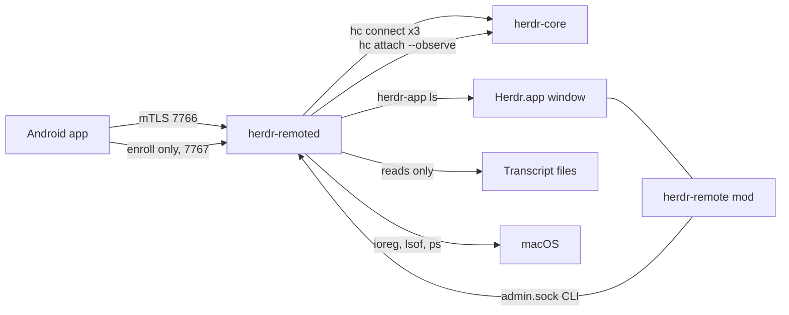
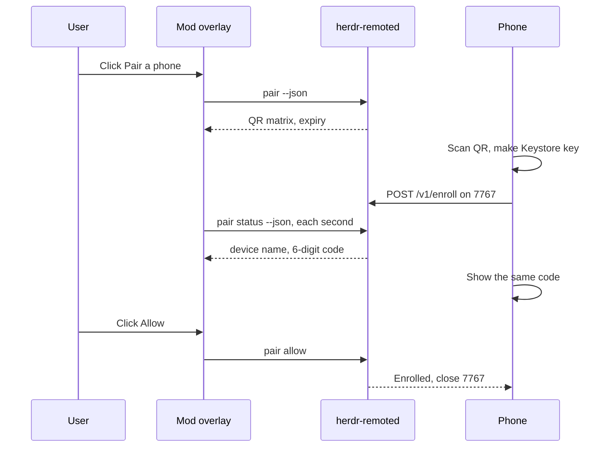
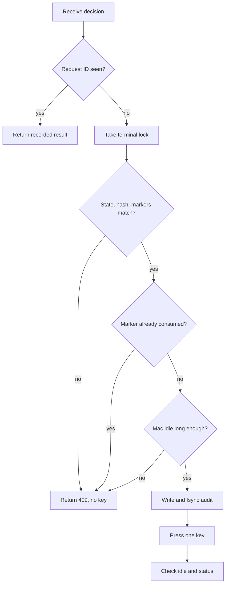
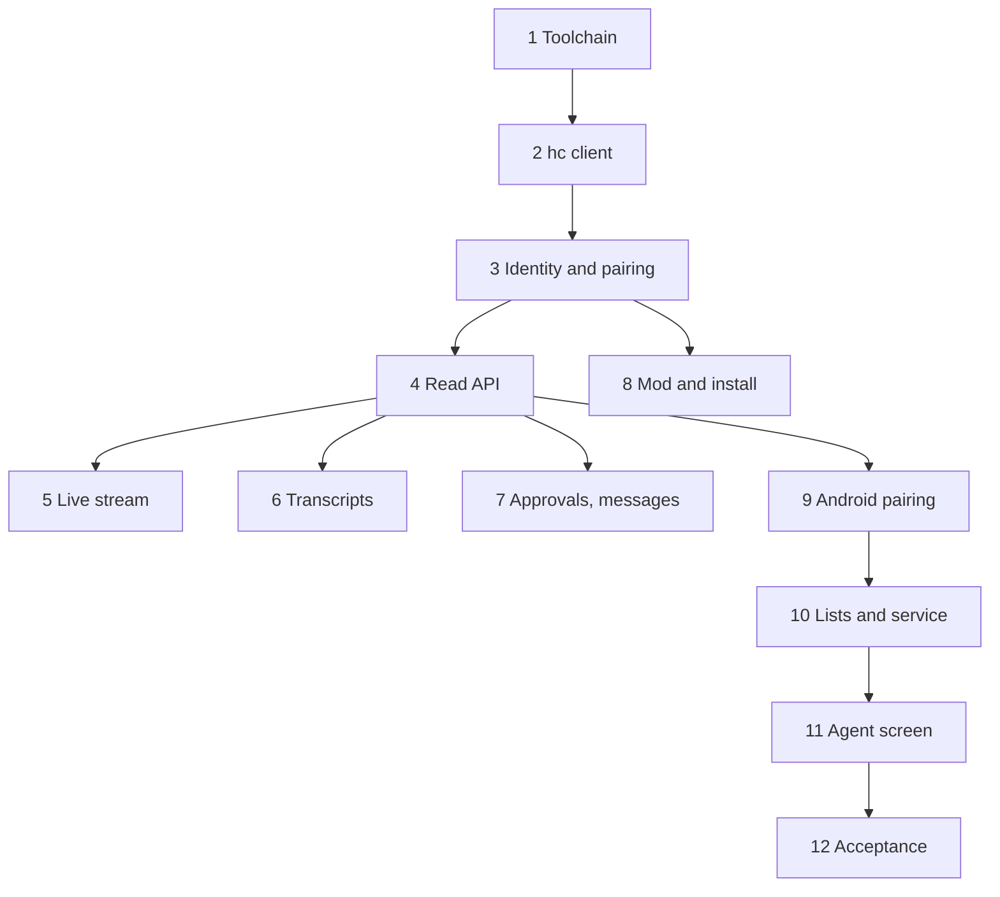

# herdr-remote: Technical Design

- **Status:** Ready for implementation.
- **Date:** 2026-11-08.
- **Repo:** `/Users/zeus/code/herdr-remote` (branch `main`, no commits at the time of this design).
- **Product requirements:** `PRD.md`.
- **Design debate:** `DEBATE.md` records how each decision was made.

## 1. Outcome

This design builds an Android app that controls Herdr.app sessions on one Mac. It has three parts:

- **`herdr-remoted`:** a Go daemon that runs as a per-user LaunchAgent.
  - It is the only part that the phone can reach.
  - It serves a small HTTPS API over mutual TLS.
  - It reaches Herdr only through the shipped `hc` and `herdr-app` commands, with a fixed set of operations in the code.
- **The `herdr-remote` mod:** a Herdr mod that opens as an overlay in the Herdr window.
  - It lists the paired phones, with a Revoke button for each.
  - Its **Pair a phone** button shows the pairing QR code.
  - It asks the user to allow or deny a new phone.
- **The Android app:**
  - Pairing: the user scans the QR code, compares a 6-digit code on both screens, and clicks Allow on the Mac.
  - Screens: spaces, the agents in a space, and all agents.
  - Per agent: the transcript, a live colored view of the terminal, Approve and Deny for a permission prompt, and a message box.
  - An optional background service shows a notification when an agent becomes blocked.

The result:

- The user can watch and unblock Claude Code and Codex agents from the phone. This works over Wi-Fi, or over Tailscale away from home.
- A phone that is not paired, or that the user revoked, cannot complete the TLS handshake on the API port (7766). The enrollment port (7767) opens only during a pairing window that the user starts on the Mac. It serves only the exchange of the one-time token.
- The phone cannot run commands, read files, or call an `hc` method outside the fixed set.
- The daemon keeps an audit log of every pairing event, revocation, decision and message.
- The daemon refuses a phone approval while someone uses the Mac keyboard or mouse.

## 2. Current behaviour

The repo is new and empty. Herdr is closed source. The facts below come from the installed tools on 2026-11-08:

| Tool | Version |
|---|---|
| Herdr.app | 0.1.13 |
| herdr-core (`hc`) | 0.1.18 |
| Claude Code | 2.1.295 |
| codex-cli | 0.167.0 |

### 2.1 herdr-core API

- **Protocol:** JSON-RPC 2.0, one message on each line, on a local socket. `hc connect` speaks the protocol over stdin and stdout (`hc connect --help`). `hc schema` prints the full OpenRPC document.
- **Read methods:**
  - `terminal.list` (with a `labels` filter and `all`).
  - `terminal.get`.
  - `terminal.read {terminal, lines}`: the screen plus `lines` of history, as text. `lines: 0` gives the visible screen only.
- **History limit:** while the status is `working`, `blocked` or `error`, `terminal.read` returns only the visible screen, marked incomplete (`hc --skill`, "History reads").
- **Events:** `events.subscribe` returns `{seq, terminals[]}`. After that, the connection carries only notifications:
  - fact changes: created, lost, restarted, finished, removed, status, turn, title, labels, size, doc
  - `heartbeat {seq}` every 15 s
  - `missed`, then a fresh snapshot, for a subscriber that falls behind.
- **Event payloads:** the schema does not describe the payloads of fact changes. A 20 s sample showed only the snapshot and `{"method":"heartbeat","params":{"seq":7637}}`.
- **Action methods:**
  - `terminal.send {terminal, text, force, if, wait, timeout}` pastes text and presses Enter. It refuses a blocked program unless `force` is true. `if` accepts only `idle` or `working`.
  - `terminal.keys {terminal, keys[]}` presses named keys and returns `KeysResult {status, turn}`. It has no blocked refusal and no status condition.
  - Both methods wait until nobody types at the Mac for about 3 s. hc holds keys that a person presses in that time.
  - A `terminal.send` from a process outside any terminal, with no `caller`, arrives as a plain prompt without an `<hc from=…>` tag. A probe Claude agent answered "PONG" to such a message.
- **Methods this design never uses:** `terminal.run`, `terminal.kill`, `terminal.rm`, `terminal.put`, `terminal.label`, `terminal.attach` (framed mode, wire format not documented), `machine.exec`, `file.read`, `file.write`, `file.edit`, `doc.get`, `doc.set`, `server.*`, `machine.*`.

### 2.2 Terminal facts

`hc get <t> --json` returns:

- `address`, `cols`, `rows`, `created_ms`, `reported`, `turn`, `title`, `state` (`live` or `finished`).
- `foreground {pid, name, argv, cwd}`. Names differ: `claude`, `claude.exe`, and `node` for npm Codex.
- `labels`. Herdr's own terminals have `herdr.space`, `herdr.tab` and `where`, for example `"where": "Niti / Niti Phase 0 PR"`.
- `status {state, app, kind, msg, title, progress}`:
  - `state` is `idle`, `working`, `done`, `blocked` or `error`.
  - `kind` is `permission`, `question` or `auth`. It is set only when the state is `blocked`.
  - `turn` goes up each time the status leaves `working`.

### 2.3 Live stream

`hc attach --observe [--history N] <t>` writes the first paint and then the live bytes to a plain pipe, with colors. It needs no TTY. It never types and never resizes. A probe terminal gave 507 bytes in 2 s, with the SGR colors intact.

### 2.4 Window model

- `herdr-app ls` returns `{spaces: [{id, name, folder, machine, active, tabs: [{id, name, active, terminals: [{terminal, pane, status, app, name, sub_agents}]}]}], recent}`.
- `hc ls` and `herdr-app ls` both work with `env -i HOME=$HOME PATH=/usr/bin:/bin`. A LaunchAgent can run them.
- A space rename does not cause an hc event.

### 2.5 Herdr mods

- A mod is trusted JavaScript in `~/.config/herdr-app/mods/<name>/` (`main.js`, `mod.json`). It can run programs with `exec` and use the network (`~/.config/herdr-app/AGENTS.md:971, 996`).
- `exec` has a limit of 30 s and 8 MiB of output (`herdr.d.ts:10`).
- `image(path)` and `svg(path)` load files from the app directory only. `div()` is a plain layout element (`gpui-kit.d.ts:20271` to `20290` in each shipped mod folder).
- A save of any file in a mod folder reloads the mod. Hidden files, `.d.ts`, `jsconfig.json` and `node_modules` are exceptions (`AGENTS.md:789`).
- Each mod redraw redraws the full window, so a mod must not redraw on a timer (`AGENTS.md:893`).
- `mod.open {name}` opens or closes a mod as the overlay that its `mod.json` describes (`herdr-app commands`).
- `herdr-app check <dir>` validates a mod. `herdr-app shot <file>` captures the window.
- The shipped mods belong to Herdr. This design does not change them.

### 2.6 Claude Code permission prompts

Verified with probe agents in `--permission-mode default`:

- **Command prompt:**
  - Status: `{app: "claude-code", kind: "permission", msg: "approve Bash: touch <path>", state: "blocked"}`.
  - Screen: `Do you want to proceed?`, `1. Yes` (with the cursor on it), `2. Yes, and always allow …`, `3. Yes, and switch to auto mode …`, `4. No`, then `Esc to cancel · Tab to amend`.
- **Write-tool prompt:**
  - Status `msg`: `approve Write: <path>`.
  - Screen: `Do you want to create <file>?`, `1. Yes` (with the cursor on it), `2. Yes, and switch to accept edits …`, `3. No`, then `Esc to cancel · Tab to amend`.
- **Keys:**
  - `hc keys <t> 1` approved. The file appeared, the status went to `done`, and the turn went from 1 to 2.
  - `esc` denied. No file appeared, the status went to `idle`, and the turn did not change.
  - "No" was option 4 in one prompt and option 3 in the other. A digit is not a safe way to deny.

### 2.7 Codex approval prompts

Verified with `codex --no-daemon -s read-only -a on-request`. This version rejects `-a untrusted`.

- **Command prompt:**
  - Status: `{app: "codex", kind: "permission", state: "blocked"}`, with no `msg`.
  - Screen: `Would you like to run the following command?`, `Reason: …`, `$ <command>`, `1. Yes, proceed (y)`, `2. Yes, and don't ask again … (p)`, `3. No, and tell Codex what to do differently (esc)`, `Press enter to confirm or esc to cancel`.
- **File-edit prompt:**
  - Screen: `Would you like to make the following edits?`, `Description: …`, `Destination: …`, `1. Yes, proceed (y)`, `2. Yes, and don't ask again for these files (a)`, `3. No, … (esc)`, `Press enter to confirm or esc to cancel`.
- **Keys:** `y` approved and `esc` denied, for both prompts.

### 2.8 Transcripts

- **Claude Code:**
  - `foreground.pid` leads to `~/.claude/sessions/<pid>.json`. Its keys include `sessionId`, `cwd` and `updatedAt`.
  - `sessionId` leads to `~/.claude/projects/<slug>/<sessionId>.jsonl`.
  - Records with `type` `user` or `assistant` have `message.content`. It is a string, or a list of `text`, `thinking`, `tool_use` and `tool_result` blocks. Other types (`attachment`, `mode`, `ai-title` and more) are not messages.
  - The sessions file appears after the first prompt.
- **Codex with `--no-daemon`:**
  - The `codex` process under the foreground process keeps its rollout file open: `~/.codex/sessions/YYYY/MM/DD/rollout-<ts>-<thread id>.jsonl` (`lsof -p`).
  - Records are `session_meta`, `response_item` (payload `message`, `custom_tool_call`, `custom_tool_call_output`), `event_msg`, `turn_context` and others.
  - Guardian sub-agent threads have their own rollout files, with `session_meta.parent_thread_id` set. The main thread has no `parent_thread_id`.
- **Codex without `--no-daemon` (daemon mode):**
  - A plain `codex` (for example terminal t1v, `node /opt/homebrew/bin/codex`) runs its threads in a shared `codex app-server` daemon, whose parent is pid 1.
  - No process of the terminal holds the rollout file. The daemon closes rollouts that are idle.
  - Each live thread has a lock file `~/.codex/thread-writer-locks/<thread id>.lock`. The process that serves the thread holds the lock: the app-server for daemon-mode threads, and the `codex` process itself for `--no-daemon` threads.
  - A Codex that has had no prompt has a lock but no rollout yet.
  - The first line of each rollout is `session_meta`, with `cwd`, `source` (`cli`, `vscode`, or an object for sub-agents), `timestamp`, and `parent_thread_id` for sub-agents.
  - No shipped interface ties a daemon-mode terminal to its thread. The files in `~/.codex/tui-thread-reference-capabilities/` are empty markers. A match by folder can pick the session of another Codex client (one outside Herdr, one that exited, or one that was resumed).
  - Herdr's own launcher for Codex runs plain `codex`: `~/.config/herdr-app/shared.json`, `new-menu.agents[1].run = ["codex"]`. `hc --skill` says that Codex under hc must run with `--no-daemon`.

### 2.9 Mac and toolchain

- `ioreg -c IOHIDSystem -d 4` prints `HIDIdleTime`: the nanoseconds since the last keyboard or mouse input on the Mac.
- Java 17 (Homebrew `openjdk@17`), Go and Swift are installed.
- The Android SDK, `adb`, Gradle and Tailscale are not installed. Homebrew has the `android-commandlinetools` cask.
- The LAN address of the Mac was `192.168.1.3`.

## 3. Decisions

### 3.1 Decision table

Each row gives the decision, the reason, and the strongest alternative that lost. `DEBATE.md` has the full argument for each one.

| # | Decision | Why | Rejected alternative |
|---|---|---|---|
| 1 | One Go daemon, `herdr-remoted`, runs as a per-user LaunchAgent. It is the only network listener. | One static binary with a good TLS stack and simple control of subprocesses. Go is installed. | Swift: the same function with more macOS-only code. A mod as the server: mods have no isolation and a 250 ms quit budget. |
| 2 | The daemon uses three long-lived `hc connect` subprocesses: reads, events and actions. It runs every other program through one helper that accepts only fixed program paths and fixed argument shapes, with no shell. There is no generic pass-through to hc. | The raw API includes `machine.exec` and `file.write`. Actions wait for the Mac keyboard to go quiet and must not block reads. A subscribed connection carries only notifications. | A JSON-RPC proxy with a method filter: one filter bug exposes everything. |
| 3 | Allowed hc use: - `hello`, `terminal.list`, `terminal.get`, `terminal.read`, `events.subscribe` - `terminal.send` with `force: false` and no `caller` - `terminal.keys` with exactly one of `["1"]`, `["y"]`, `["esc"]`, called only from the approval code - `hc attach --observe`. A target must match `^t[0-9a-z]+$` (no `machine/` prefix), be `live`, and have `reported: true`. | It is the minimum for the requested screens. Each check fails toward a refusal. | `terminal.interrupt` or a keyboard: out of scope, by user decision. |
| 4 | Two TLS listeners share one P-256 self-signed server key. The phone pins its SPKI SHA-256. - **Paired listener, port 7766:** always on. - **Enrollment listener, port 7767:** exists only while a pairing window is open. It serves only `POST /v1/enroll`. Go settings on both: `MinVersion: tls.VersionTLS13`, `ClientAuth: tls.RequireAnyClientCert`, `SessionTicketsDisabled: true`, and all client checks in `VerifyConnection`, never in `VerifyPeerCertificate`. Checks per listener: - **7766:** the client SPKI hash must be in the device store. Each request looks the device up again. - **7767:** the client must present one well-formed P-256 certificate. The token, bound to that SPKI, is the authorization. The device store is not used. | The handshake cannot see the request path. With two listeners, the paired listener never accepts an unknown key. `VerifyConnection` runs on all handshakes, including resumptions, but `VerifyPeerCertificate` does not. Tickets off stop a revoked phone that tries to resume a session. A key pin makes LAN and Tailscale addresses work the same way. | One listener with path middleware: unknown keys reach the HTTP parser while pairing is open. A relay: the user ruled it out. |
| 5 | HTTP on the TLS listeners: - JSON for reads and actions - Server-Sent Events (SSE) for `/v1/events`, with a comment line every 10 s - a chunked `application/octet-stream` body for the live view. Phone read timeouts: - SSE: 30 s, then reconnect - live view: none, and the phone reopens each live view when SSE reconnects - `/v1/enroll`: 130 s - other calls: 15 s. Action calls set `retryOnConnectionFailure(false)`. The listeners use TCP keepalive (the Go default, 15 s). Go uses the standard library plus a QR encoder. | The live view is watch-only, so one-way streams are enough. The SSE keepalive gives a liveness signal for the whole connection. An idle terminal sends no bytes, so the live view cannot have a read timeout. | WebSocket: needs a Go library and adds nothing here. No SSE timeout: a dead socket after a network change is never found. |
| 6 | Pairing: see section 3.3. The overlay opens to the device list. Only **Pair a phone** opens a 120 s window and port 7767. The QR is drawn with run-length `div()` rows, with no file on disk and no countdown redraw. The phone confirms a 6-digit code, and the user clicks Allow on the Mac. | A leaked QR (a screen share, a photo) alone enrolls nothing. `exec` has a 30 s limit, so the overlay polls short status calls. A revoke must not open the enrollment port. | A token only: a QR seen on a screen share is enough. A hidden SVG file: avoids the mod reload but writes the token to disk. |
| 7 | Revocation: `herdr-remoted devices rm <id>`, or Revoke in the overlay, deletes the device, closes its connections and ends its live-view subprocesses. | A lost phone loses access at once, with its open streams. | Certificate expiry only: too slow. |
| 8 | Live view: section 3.4 gives the endpoint. The phone shows xterm.js in a locked-down WebView at the terminal's own `cols` and `rows`, scaled to the screen width, with pinch zoom. - Flow control: base64 chunks of at most 64 KiB. Each chunk waits for the xterm.js `write` callback. At more than 1 MiB pending, Kotlin drops the queue and reopens the stream. - On a `size` event, the daemon ends the live streams of that terminal. The phone reopens one for a fresh paint. - A device can have at most 2 live views. | Verified: the stream is colored and incremental, with no PTY and no protocol decode. A fresh paint from `attach` makes it safe to drop a backlog. | `terminal.read` at 4 Hz: plain text and 250 ms steps. Unbounded writes: xterm.js drops data past its buffer limit. |
| 9 | Transcripts: section 3.6 gives the three sources, in order: the Claude sessions file, the open rollout file of a Codex with `--no-daemon`, and terminal text. A Codex in daemon mode shows terminal text, with the hint "Start Codex with `--no-daemon` for the full transcript". Pages are aligned to records, and cursors are tied to the file. | Each source is an exact identity, verified on live agents. A wrong transcript is worse than terminal text, because the user reads it before an approval. | A folder match for daemon-mode Codex: three review rounds found cases where it shows another session (an outside client, an exited session, a resume). Codex's `state_5.sqlite`: undocumented, needs SQLite, and has no terminal binding either. |
| 10 | Approvals: section 3.5 gives the full guard, in this order: 1. only `blocked` with `permission`, for `claude-code` or `codex`. 2. a known request ID returns its result. 3. a per-terminal lock. 4. the same turn, prompt hash and option markers. 5. a consumed marker. 6. the Mac-in-use guard. 7. a fsynced audit line. 8. exactly one key. | The keys and markers were verified on command and file-edit prompts for both agents. `1` selects Yes at any cursor position. `esc` is the only deny that does not depend on option order. The marker and request IDs stop retries and second phones, and the audit log keeps them through a restart. The idle guard closes the main path to the race. | A separate durable store: the audit log already is one. `enter` on a selected Yes: depends on the cursor. No guard: a key could approve a prompt that nobody saw. |
| 11 | Questions (`kind: question`), `auth` prompts, Pi and unknown apps are view-only. The phone says "Answer this on the Mac". | The user scoped control to approve, deny and message. Question menus differ, so a digit can pick the wrong answer. | Digits 1 to 9: one wrong parse answers for the user. |
| 12 | Messages: `POST /message {request_id, text}` calls `terminal.send` with `force: false` and no `caller`, so the text arrives as a plain prompt. - Targets: live terminals with `reported: true`. - The daemon removes C0 and C1 control characters, but keeps `\n` and `\t`. The limit is 4000 characters. - A fsynced `dispatching` audit line `{request_id, terminal, length}` comes first. It has the text length, never the text or a hash of it. If the write fails, the daemon returns 503 and sends nothing. - Delivery is at most once for each `request_id`. - A blocked agent refuses the message. | It matches the scope. The filter stops input that tries to break out of the paste. The request ID stops a retry that sends the prompt twice. A `caller` would tag the text as a report from another agent. | Raw keys: out of scope. |
| 13 | Background alerts: an opt-in foreground service holds `/v1/events`. Section 3.7 lists the manifest. It shows one notification for each blocked episode (terminal, turn, `msg`). After a reconnect, the snapshot shows agents that are still blocked. Alerts come only while the service runs and is connected. | No relay or push service, by user decision. `specialUse` is not on the Android 15 list of types that `BOOT_COMPLETED` cannot start. | FCM: needs a server and Google credentials. `dataSync`: limited to 6 hours a day on Android 15. |
| 14 | Phone key and privacy: section 3.7 gives the key parameters. The key is not bound to an unlocked device. The app asks for BiometricPrompt after 5 minutes in the background, sets `FLAG_SECURE`, and uses private notifications. Transcripts and terminal bytes stay in memory. No build logs content. Notifications have no action buttons. | A key bound to an unlocked device makes each handshake fail while the phone is locked, which stops alerts. The gate, `FLAG_SECURE` and private notifications keep project data off the lock screen and out of recents. | `setUnlockedDeviceRequired`: stops background alerts. Full text in notifications: shows commands on the lock screen. |
| 15 | Android stack: Kotlin and Jetpack Compose, minSdk 31, targetSdk 35. OkHttp for TLS, SSE and streams. kotlinx.serialization. Google Play services code scanner (no camera permission). androidx.biometric. xterm.js 5.x as a bundled asset. One activity, ViewModels, no DI framework. | The smallest standard stack. | Termux terminal-view: a JitPack dependency and more glue code. React Native or Flutter: more toolchain. |
| 16 | Spaces and agents: - `/v1/spaces` runs `herdr-app ls` on each request, and also on created, removed and labels events. It drops spaces whose `machine` is set. - An agent is a live local terminal with `reported: true`. Its space comes from `herdr-app ls`, or else from its `herdr.space` label. - If Herdr.app is not open, the API groups agents by their `where` label under "Herdr window closed". | A space rename causes no hc event. Remote machines are out of scope. | A poll timer: a refresh on request is simpler and always current. |
| 17 | Logging and audit: section 3.6 gives the formats. `audit.log` records every pairing event, revocation, decision, refusal and message. `dispatching` lines are fsynced before any key or send. Logs never contain tokens, codes, keys, transcript text, terminal bytes or message text. | The user needs a record of what a phone did. The audit log also keeps request IDs through a restart. | No audit: no way to see what a lost phone did. |
| 18 | Trust boundary: processes that run as the same macOS user are trusted. They can already drive hc directly, read `server.key` and `devices.json`, or run `herdr-remoted pair allow`. File modes cannot stop them. The design protects against the network (LAN and tailnet), leaked QR codes, lost phones, second phones, replays, and hostile bytes in terminal output or transcripts. | File permissions cannot separate processes of one user. A clear statement prevents false assurance. | A separate macOS user or a Keychain-protected key: real isolation, but much more setup, and agents can still drive hc. |

### 3.2 Architecture

This diagram shows the parts and the calls between them.

- The phone reaches only the daemon, on two ports.
- The daemon reaches herdr-core through `hc connect` and `hc attach --observe`, never through the socket directly.
- The mod runs inside Herdr.app and calls the daemon CLI, which talks to the daemon through `admin.sock`.

### 3.3 Pairing flow

This sequence shows how a new phone becomes a paired device.

Rules:

1. The user opens the overlay with `herdr-app do mod.open --name herdr-remote`. The same command closes it. The overlay shows the paired devices, and Revoke for each.
2. **Pair a phone** runs `herdr-remoted pair --json`. The daemon opens a 120 s window and port 7767, and returns `{matrix, expires_at}`.
3. The overlay draws the matrix as run-length `div()` segments for each row. It shows the expiry as a clock time. It writes no file and does not redraw on a timer.
4. The QR text is `herdr-remote://pair?v=1&pin=<b64url SPKI sha256>&ep=<addr>,<addr>&p=7766&ep_port=7767&t=<token>&exp=<unix>`.
   - `ep` lists the private IPv4 addresses of active interfaces, any `100.64.0.0/10` address, and the MagicDNS name if `tailscale status --json` gives one.
   - The token is 32 random bytes, kept in memory only.
5. The phone makes a P-256 key in Android Keystore. It calls `POST /v1/enroll {token, name}` on 7767.
   - `name` must be 1 to 64 printable characters.
   - The token binds to the first client SPKI that uses it. The daemon refuses other SPKIs, but accepts the same SPKI again, so the phone can retry.
   - The call long-polls until Allow, Deny or expiry.
6. The overlay polls `herdr-remoted pair status --json` each second. Each call returns at once. The overlay redraws only when the state changes.
7. The overlay and the phone both show a 6-digit code: the first 4 bytes of SHA-256(server SPKI DER ‖ client SPKI DER), read as a big-endian unsigned integer, mod 1,000,000, with leading zeros to 6 digits.
8. Allow (`pair allow`) stores the device. Deny (`pair deny`), Cancel, a closed overlay (`pair cancel`) or expiry stores nothing. Then the window and port 7767 close.
9. The mod calls the daemon by the absolute path that `install.sh` writes into `main.js`.

### 3.4 API

All endpoints except `/v1/enroll` are on port 7766. Bodies are JSON unless the table says otherwise.

| Method and path | Request | Response |
|---|---|---|
| `POST /v1/enroll` (7767 only) | `{token, name}` | 200 `{device_id}` after Allow. 403 on Deny, a wrong token, or a token bound to another key. 410 on expiry or cancel. |
| `GET /v1/hello` | none | `{daemon_version, server_time_ms, endpoints[]}` |
| `GET /v1/spaces` | none | `[{id, name, agents[]}]` |
| `GET /v1/agents` | none | `[agent]` |
| `GET /v1/terminals/{t}` | none | `agent` plus `{cols, rows}` |
| `GET /v1/events` | none | SSE. `snapshot` event (all agents) on connect and after `missed`. `agent` event for each change. `agent_removed {address}` when a terminal finishes, is removed, or stops being an agent. `: ka` comment every 10 s. |
| `GET /v1/terminals/{t}/live` | none | Chunked `application/octet-stream` from `hc attach --observe --history 500`. |
| `GET /v1/terminals/{t}/transcript?cursor=<opaque>` | none | `{source, hint?, items[], next_cursor}`. `source` is `claude`, `codex` or `terminal`. |
| `GET /v1/terminals/{t}/prompt` | none | `{app, kind, msg, block, turn, prompt_hash, actionable, reason?}` |
| `POST /v1/terminals/{t}/decision` | `{request_id, decision, turn, prompt_hash}` | `{result}`: `applied`, `sent_unconfirmed`, `uncertain` or `outcome_unknown` |
| `POST /v1/terminals/{t}/message` | `{request_id, text}` | `{result}`: `sent` or `outcome_unknown` |

- `agent` is `{address, space, tab, where, app, state, kind, msg, turn, title}`.
- A transcript item is `{role, kind, text, ts}`. `kind` is `text`, `tool_call` or `tool_result`. Tool results are cut to 2000 characters. Thinking blocks are not sent.
- `agent` is the full shape above. `state` is the hc status word (`idle`, `working`, `done`, `blocked`, `error`), and `kind` and `msg` are set only when blocked.
- `request_id` is a UUIDv7 that the phone makes for each user action. The phone sets its time from its own clock plus the offset to `server_time_ms` from `/v1/hello`, so clock skew does not matter.
- Errors are `{error, reason}`:

| Status | Use |
|---|---|
| 400 | Bad target, bad body, text too long. |
| 401 | Unknown or revoked device (after the handshake). |
| 404 | No such terminal. |
| 409 | Guard failure. `reason` is `stale`, `changed`, `already_answered`, `mac_in_use`, `not_actionable`, `blocked`, `not_agent`, `cursor` or `expired_request`. `mac_in_use` also has `idle_ms`. |
| 429 | More than 2 actions (decisions and messages) in one second from one device. |
| 503 | hc unavailable, or an audit write failed. |

### 3.5 Approval guard

This flow shows the order of the checks for one decision.

The rules, in order:

1. The approval applies only when `state = blocked`, `kind = permission`, and `app` is `claude-code` or `codex`.
2. `GET /prompt` returns `block` and `prompt_hash`:
   - `block` is the screen region from the line that starts the dialog (`Do you want` or `Would you like`) to the line with `Esc to cancel` or `Press enter to confirm`.
   - `prompt_hash` is SHA-256(`app` ‖ `turn` ‖ `msg` ‖ `block`).
3. `POST /decision` checks `request_id` first:
   - An ID whose UUIDv7 time is more than 5 minutes from the daemon clock returns 409 `expired_request`.
   - A known ID returns its recorded result, whatever the body.
   - An ID with a `dispatching` line and no result line returns `outcome_unknown`.
4. Under a per-terminal lock, the daemon reads `terminal.get` and `terminal.read(lines 0)` again. It requires all of these:
   - the same state, kind, app and turn
   - the same `prompt_hash`
   - the option markers on the screen. Claude: `1. Yes` and `Esc to cancel`. Codex: `Yes, proceed (y)` and `(esc)`
   - a consumed marker for the terminal that is not already `{turn, prompt_hash}`.
5. **Mac-in-use guard (a heuristic), the last check:**
   - If `HIDIdleTime` is less than the `mac_idle_seconds` setting (default 10), the daemon returns 409 `mac_in_use` with `idle_ms` and audits the refusal. A value of 0 turns the guard off.
   - If `ioreg` fails, or its output does not parse, the daemon refuses (fail closed).
   - The guard sees local keyboard and mouse input. It does not see SSH sessions, or `hc send` and `hc keys` from other terminals and agents. hc's 3 s quiet rule covers those. Remote-desktop input is not verified.
6. The daemon appends `{action: decision, state: dispatching, request_id, terminal, turn, prompt_hash, decision}` to `audit.log` and fsyncs it. If the write fails, it returns 503 and presses no key.
7. The daemon sets the consumed marker and presses one key: Claude `1` or `esc`, Codex `y` or `esc`.
8. The daemon reads `HIDIdleTime` again:
   - If the new idle time is less than the time since the idle check in rule 5, the Mac had input during the call, and the result is `uncertain`.
   - If not, the daemon reads the status for up to 3 s. The result is `applied` if the status or turn moved, or `sent_unconfirmed` if not.
9. The daemon appends the result line. It never presses a key again for that request.
10. Retention:
   - The daemon keeps every accepted request ID for 10 minutes. That is longer than the 5-minute window in which an ID is valid, so it never forgets an ID that it could still accept.
   - It keeps the consumed marker of a terminal until the terminal's turn changes or the terminal ends.
   - On start, it rebuilds both from the last 10 minutes of `audit.log` and `audit.log.1`.
   - The rate limit (2 actions a second for each device) keeps 10 minutes of audit lines far below the 10 MiB rotation size, so a rotation cannot drop a valid ID.

### 3.6 Files and formats

**State directory:** `~/Library/Application Support/herdr-remote/` (mode 0700).

| File | Mode | Content |
|---|---|---|
| `server.key` | 0600 | P-256 private key. |
| `server.crt` | 0644 | Self-signed, valid for ten years, subject `CN=herdr-remoted`. |
| `devices.json` | 0600 | `[{id, name, spki_sha256, added}]`, written atomically (temporary file, then rename). |
| `admin.sock` | 0600 | Socket for the CLI commands. |
| `audit.log` | 0600 | JSON lines. Rotates at 10 MiB to `audit.log.1`. |
| `daemon.log` | 0600 | LaunchAgent stdout and stderr. Rotates at 10 MiB. |
| `config.json` | 0600 | Optional. `{"mac_idle_seconds": 10}`. |

**CLI commands** (through `admin.sock`, each returns within 1 s):

| Command | Result |
|---|---|
| `herdr-remoted serve` | Runs the daemon. The LaunchAgent uses it. |
| `pair --json` | Opens a window. Returns `{matrix, expires_at}`. |
| `pair status --json` | `{state, device_name?, code?}`. `state` is `none`, `open`, `pending`, `allowed`, `denied` or `expired`. |
| `pair allow`, `pair deny`, `pair cancel` | Changes the window state. |
| `devices ls --json` | `[{id, name, added}]` |
| `devices rm <id>` | Revokes the device. |

**Audit line:** `{ts, device_id, action, state, terminal, turn, request_id, decision, prompt_hash, length, idle_ms, result}`, with only the fields that apply.

- `action` is `enroll`, `allow`, `deny`, `revoke`, `decision`, `message` or `refusal`.
- A message line has `length`, the number of characters. It never has the text or a hash of it, because a hash of a short text is easy to guess.
- A request ID is valid for 5 minutes from its UUIDv7 time. The daemon remembers it for 10 minutes. The phone abandons a request that has no answer after 5 minutes, and shows "Outcome unknown".

**Never logged anywhere:** tokens, pairing codes, keys, transcript text, terminal bytes, message text.

**Transcript sources**, tried in order. Each one is an exact identity:

1. **Claude:** `foreground.pid` → `~/.claude/sessions/<pid>.json` → `sessionId` → the single match of `~/.claude/projects/*/<sessionId>.jsonl`.
2. **Codex `--no-daemon`:** walk the child processes of `foreground.pid` with `ps` to the process named `codex`. Run `lsof -Fn -p <pid>` and keep the open `~/.codex/sessions/**/rollout-*.jsonl` files. Use the one whose `session_meta` has no `parent_thread_id`.
3. **Terminal text:** `terminal.read` with `lines: 2000`, labelled "terminal text". While the agent is working or blocked, this is the visible screen only. For a Codex that sources 1 and 2 cannot bind (daemon mode), the response has the hint "Start Codex with `--no-daemon` for the full transcript".

**Transcript rules:**

- The real path (after symlinks) must be under `~/.claude/projects` or `~/.codex/sessions`.
- A page is a byte range, read back from the end, of at most 2 MiB. A page that starts inside the file drops all bytes up to the first newline.
- A record longer than one page shows as `[record too large]`. A partial last line is ignored.
- The cursor is `{file, inode, offset}`, encoded as opaque base64. A cursor for a different file returns 409 `cursor`. The phone then starts again from the end.

### 3.7 Android app

**Screens:**

| Screen | Content |
|---|---|
| Pair | Code scanner, 6-digit code, wait for Allow. |
| Spaces | Spaces with agent counts and the most urgent status. |
| Space | Agents in the space, with status and tab name. |
| All agents | Every agent. Blocked agents first. |
| Agent | Tabs: Transcript, Live. A prompt card with Approve and Deny when actionable. A message box. |
| Settings | Paired Mac, background watching, Forget this Mac. |

**Key (Android Keystore):** P-256, `PURPOSE_SIGN`, digests `SHA256` and `NONE`, `setUserAuthenticationRequired(false)`, not bound to an unlocked device. The chain is the self-signed certificate that Keystore makes.

**TLS client:**

- An `X509KeyManager` returns the Keystore alias, its private key and its chain.
- An `X509TrustManager` and a `HostnameVerifier` both accept only a leaf certificate whose SPKI SHA-256 equals the pin. Certificate names and IP addresses play no part.
- An OkHttp `ConnectionSpec` allows TLS 1.3 only.
- The app remembers the last endpoint that worked, tries the others in order, and refreshes the list from `/v1/hello`.

**WebView for the live view:**

- JavaScript is on. `WebViewAssetLoader` serves the bundled assets.
- Every other request is blocked. File and content access are off.
- The page receives bytes only. It never sends input.

**Manifest:**

- Permissions: `INTERNET`, `FOREGROUND_SERVICE`, `FOREGROUND_SERVICE_SPECIAL_USE`, `POST_NOTIFICATIONS`, `RECEIVE_BOOT_COMPLETED`, `REQUEST_IGNORE_BATTERY_OPTIMIZATIONS`, `USE_BIOMETRIC`.
- The service has `android:foregroundServiceType="specialUse"` and the `PROPERTY_SPECIAL_USE_FGS_SUBTYPE` property.
- `BOOT_COMPLETED` and `MY_PACKAGE_REPLACED` receivers start the service again if the toggle is on.

**Background service:**

- The app starts it while in the foreground. It shows an ongoing notification, "Watching N agents".
- If notifications are denied, the toggle explains why and stays off.
- The app asks for an exemption from battery optimization.

**Privacy:**

- The activity sets `FLAG_SECURE`.
- Notifications use `VISIBILITY_PRIVATE`. The public version says "An agent needs attention". The private version shows the tab name and "permission". It never shows the command.
- After 5 minutes in the background, the app asks for BiometricPrompt (strong biometric or the device credential) before it shows anything.
- Approve, Deny and messages work only in the unlocked, authenticated app.
- The app never retries an action by itself. If the outcome is unknown, it says "Check the transcript before you send again".

### 3.8 Herdr mod

- Folder: `~/.config/herdr-app/mods/herdr-remote/`, with `mod.json` (overlay) and `main.js`.
- The overlay opens to the device list, with Revoke for each device.
- **Pair a phone** calls `pair --json`, draws the QR and shows the expiry time.
- A `cx.spawn` loop calls `pair status --json` each second. It calls `cx.notify()` only when the state changes.
- When a phone is pending, the overlay shows its name, the 6-digit code, Allow and Deny.
- Closing the overlay calls `pair cancel`.
- The mod writes no file. No `exec` call can reach 30 s.

## 4. Scope and acceptance criteria

**Delivered:**

- `daemon/`
- `mod/herdr-remote/`
- `android/`
- `scripts/setup-android.sh`
- `scripts/install.sh`

**Out of scope:**

- keyboard input into terminals, answers to questions, interrupts
- start or stop of agents, spaces or tabs
- remote `hc` machines
- iOS
- a relay or push service
- a Play Store release
- changes to Herdr or its shipped mods.

**Acceptance criteria:**

1. `herdr-remoted` runs under a LaunchAgent and starts again after a reboot. A TLS client without a certificate, or with an unpaired one, fails the handshake on 7766. Port 7767 is closed outside a pairing window.
2. The overlay shows the paired devices. **Pair a phone** shows a QR code.
   - A scan shows a 6-digit code on the phone that matches the Mac.
   - After Allow, the phone is paired.
   - Deny, no Allow, or 120 s stores nothing.
   - A second phone with the same token is refused.
3. The app lists spaces with their Herdr names. A space lists its agents with status. The all-agents view lists every local agent. A status change on the Mac shows on the phone within 2 s.
4. The transcript shows user and assistant messages and tool calls, and pages back across at least three pages, for a Claude Code agent and for a Codex agent with `--no-daemon`. Other agents show labelled terminal text. A Codex in daemon mode also shows the `--no-daemon` hint.
5. The live view shows the terminal in color and follows new output within about 1 s on the LAN. It recovers after a pane resize on the Mac, after heavy output, and after a network change.
6. The user can approve or deny a blocked Claude Code or Codex permission prompt, for a command or a file edit, from the phone. The agent then continues. The daemon presses no key, and the phone says why, if:
   - the prompt changed
   - someone answered it on the Mac
   - another phone or a retry already answered it
   - the Mac had keyboard or mouse input within `mac_idle_seconds` (a heuristic that does not see SSH or input from other agents)
   - the daemon restarted during the action (the result is `outcome_unknown`).
7. A message from the phone reaches an idle or working agent as a new, untagged prompt. The daemon sends it at most once for each request, also after a retry or a daemon restart. If the outcome is unknown, the phone says so and does not resend. A blocked agent refuses the message, with a reason.
8. With background watching on and the app closed, a newly blocked agent causes one notification within 5 s, while the service runs and is connected. Watching starts again after a phone reboot and an app update.
9. A revoke on the Mac ends the open streams of that phone within 2 s. Later handshakes fail, also when the phone tries to resume a TLS session.
10. The same pairing works over Tailscale from a cellular connection.
11. After 5 minutes in the background, the app asks for a biometric or the device credential before it shows anything.
12. The recents screen shows no app content. The lock screen shows only "An agent needs attention".
13. `audit.log` has a line for every pairing event, revocation, decision and message. It contains no token, code, transcript text, terminal bytes or message text.

**Failure cases to handle (no others):**

| Case | Behaviour |
|---|---|
| hc unavailable | The daemon returns 503 and reconnects. The phone shows the last data with its age. |
| `missed` event | The daemon takes a fresh snapshot. |
| Herdr.app closed | Agents are grouped by `where`. |
| Transcript missing or bad | The next source, ending at terminal text. |
| Endpoint unreachable | The phone tries the next endpoint and remembers the last good one. |
| Size change | The live stream starts again. |
| Device revoked during a stream | The daemon closes the stream. |
| Guard failure, or Mac in use | 409 with a reason. |
| Audit write failure | 503, no key, no send. |
| SSE silent for 30 s | The phone reconnects and reopens live views. |
| Live backlog over 1 MiB | The phone reopens the stream. |
| Transcript cursor for another file | 409, and the phone starts from the end. |
| Notifications denied | Background watching stays off, with an explanation. |

## 5. Implementation plan

Each step has: **Change**, **Implements**, **Invariant**, **Verified today**, **Depends on**, **Check**. All paths are proposed, because the repo is empty.

This diagram shows the order of the steps.

**Step 1. Toolchain and skeleton.**
- **Change:**
  - `scripts/setup-android.sh`:
    1. `brew install --cask android-commandlinetools` and `brew install gradle`.
    2. `sdkmanager --licenses`.
    3. `sdkmanager "platform-tools" "platforms;android-35" "build-tools;35.0.0" "emulator" "system-images;android-35;google_apis_playstore;arm64-v8a"`.
    4. `avdmanager create avd -n herdr-remote -k "system-images;android-35;google_apis_playstore;arm64-v8a"`.
  - `daemon/go.mod`, module `herdr-remote/daemon`.
  - `android/`: a Gradle project with a wrapper from `gradle wrapper`.
  - `.gitignore` for build output and `local.properties`.
- **Implements:** user decision 3, decision 15.
- **Invariant:** outside the repo, only Homebrew packages and the SDK directory change.
- **Verified today:** no SDK, `adb` or Gradle. Java 17 is present. The cask exists.
- **Depends on:** nothing.
- **Check:** `go version`. `adb version`. `cd android && ./gradlew assembleDebug` builds an empty Compose app.

**Step 2. Subprocess helper, hc client, event fixtures.**
- **Change:**
  - `daemon/run.go`: the only way the daemon starts a process. It accepts only `hc`, `herdr-app`, `lsof`, `ps`, `ioreg` and `tailscale`, at absolute paths found at start. It uses fixed argument shapes, no shell and a timeout.
  - `daemon/hc.go`: three `hc connect` connections (reads, events, actions) with JSON-RPC lines. Typed functions only:
    - `List`, `Get`, `Read(t, lines)`, `Subscribe`
    - `Send(t, text)`, which always sends `force: false` and never a `caller`
    - `Keys(t, k)`, where `k` is `1`, `y` or `esc`.

    The client checks targets as in decision 3 and reconnects with backoff.
  - `daemon/idle.go`: `MacIdle()` parses `HIDIdleTime` from `ioreg -c IOHIDSystem -d 4`.
  - Event fixtures: run `hc events --json` while a probe agent goes from working to blocked to idle. Save the output as `daemon/testdata/events-*.jsonl`. Write the event structs from these files.
- **Implements:** decisions 2, 3 and 10 (idle).
- **Invariant:** no code path sends a method outside the list, sets `force`, sets `caller` or sends another key. Each fails toward a refusal.
- **Verified today:** the methods and parameters in `hc schema`. `hc connect` exists. Access from a bare environment works. `HIDIdleTime` prints.
- **Depends on:** step 1.
- **Check:** `cd daemon && go test ./...` with a fake `hc` test binary that records each request. The tests fail on:
  - a method outside the list
  - `force: true`
  - a `caller`
  - another key
  - a `machine/` target
  - a program outside the helper list.

  A parser test covers `MacIdle`.

**Step 3. Identity, device store, pairing, admin socket, audit log.**
- **Change:**
  - `daemon/tls.go`, `daemon/devices.go`, `daemon/pair.go`, `daemon/admin.go`, `daemon/audit.go`.
  - The state directory and files in section 3.6.
  - The TLS settings in decision 4, with the checks for each listener.
  - The CLI commands in section 3.6.
  - Endpoints for the QR, as in section 3.3.
  - A small Go QR library. Record the choice in "As built".
- **Implements:** decisions 4, 6, 7, 17 and 18.
- **Invariant:**
  - An unknown key fails the handshake on 7766.
  - A token is single-use, binds to its first SPKI, and lives 120 s.
  - No device is stored without Allow.
  - No secret is logged.

  Each fails toward a refusal.
- **Verified today:** nothing exists.
- **Depends on:** step 2.
- **Check:** Go tests:
  - A new key enrolls through the real 7767 listener and succeeds after Allow.
  - An Allow 60 s after the scan still completes the long-poll.
  - Deny, cancel and expiry store nothing.
  - A second SPKI with the same token is refused.
  - A `name` that is too long or not printable is refused.
  - Port 7767 is closed after the window.
  - An unpaired certificate fails on 7766.
  - After `devices rm`, a client that tries to resume its earlier session fails the handshake. The test client uses `tls.Config.ClientSessionCache`.
  - After a full pairing, `audit.log` contains neither the token nor the code.

  Also: `openssl s_client -connect 127.0.0.1:7766` without a certificate fails.

**Step 4. Read API and events.**
- **Change:** `daemon/api.go` and `daemon/state.go`, with the read endpoints and SSE in section 3.4 and the errors in section 3.4. State follows decision 16.
- **Implements:** decisions 5 and 16.
- **Invariant:**
  - If hc is lost: 503, and reconnect.
  - On `missed`: a fresh snapshot.
  - The requests and streams of a revoked device end.
- **Verified today:** the shape of `herdr-app ls`, the snapshot and the heartbeat.
- **Depends on:** step 3.
- **Check:** Go tests with the fake hc and the step 2 fixtures (snapshot, status change, missed). A test that a renamed space shows on the next `/v1/spaces`. A test that SSE sends `: ka` within 11 s on an idle system. A test that a finished terminal causes `agent_removed`. Manual: `curl --cert … --key … -k https://127.0.0.1:7766/v1/agents`.

**Step 5. Live stream.**
- **Change:** `daemon/live.go`. `GET /v1/terminals/{t}/live` runs `hc attach --observe --history 500 <t>` through the helper. It copies stdout and flushes each read. A device has at most 2 streams. A stream ends on a client disconnect, on a `size` event for `t`, or on a revoke.
- **Implements:** decisions 7 and 8.
- **Invariant:** the phone never writes to the terminal. Each stream that ends kills its subprocess.
- **Verified today:** the probe streamed colored bytes to a pipe.
- **Depends on:** step 4.
- **Check:** Go tests: the subprocess count goes back to zero after a disconnect, after a size event, and after `devices rm`, within 2 s. Manual: `curl -N` shows bytes.

**Step 6. Transcripts.**
- **Change:** `daemon/transcript.go`, with the three sources and the rules in section 3.6, and the transcript endpoint in section 3.4.
- **Implements:** decision 9.
- **Invariant:** the daemon reads only files whose real path is under the two roots. A source that cannot resolve passes to the next one, which ends at terminal text. The only error is 409 for a cursor of a different file.
- **Verified today:** the mapping chains, record types, `parent_thread_id`, and the missing binding for daemon-mode Codex (section 2.8).
- **Depends on:** step 4.
- **Check:** Go tests on JSONL fixtures that the tests write:
  - Claude and Codex parse
  - a partial last line
  - a page boundary inside a record
  - a record of more than 2 MiB
  - three pages back, with no record lost or repeated
  - a stale cursor after the file changes
  - a symlink to a path outside the roots, refused
  - two open rollouts, where the guardian one is ignored
  - a daemon-mode Codex (no open rollout in its processes) gets terminal text with the `--no-daemon` hint
  - no sessions file, which falls back to terminal text.

**Step 7. Approvals and messages.**
- **Change:** `daemon/actions.go`, with the prompt, decision and message endpoints in section 3.4, the guard in section 3.5, and decision 12. The daemon rebuilds request IDs and markers from the audit log on start.
- **Implements:** decisions 10, 11, 12 and 17.
- **Invariant:** the daemon presses a key only after every guard passes. It presses at most once for each `{turn, prompt_hash}` and each `request_id`, also after a restart. Otherwise it returns 409 and presses no key.
- **Verified today:** the keys and markers for command and file-edit prompts (sections 2.6 and 2.7). The narrow race through `terminal.keys` is known.
- **Depends on:** steps 3 and 4.
- **Check:** Go tests with the fake hc and a fake `ioreg`:
  - A stale turn, a changed hash, missing markers, `kind: question`, `app: pi` and a `machine/` target each press no key.
  - Two decisions at the same time press exactly one key.
  - The same `request_id` twice returns the first result, with one key, also with a different body.
  - A `request_id` older than 5 minutes returns `expired_request`.
  - A third action within one second returns 429.
  - A restart between `dispatching` and the result returns `outcome_unknown` for that ID, and no key.
  - After a restart, the daemon rebuilds the consumed marker and the request IDs from the audit log, also across a rotation.
  - A failed audit write returns 503 and presses no key.
  - An `ioreg` failure refuses.
  - A retry after a dropped response, with the fake status held the same, presses exactly one key.
  - Idle below 10 s returns `mac_in_use`. Input during the call returns `uncertain`.
  - A message with ESC and C1 bytes arrives clean. The same message `request_id` sends once.
  - A blocked target refuses a message.

  Manual: the probes in section 6.

**Step 8. Herdr mod and install.**
- **Change:**
  - `mod/herdr-remote/mod.json` and `main.js`, as in section 3.8.
  - `scripts/install.sh`:
    1. Build the daemon to `~/.local/bin/herdr-remoted`.
    2. Write `~/Library/LaunchAgents/dev.herdr-remote.plist` with `ProgramArguments` `[<path>, serve]`, `RunAtLoad`, `KeepAlive`, and `StandardOutPath` and `StandardErrorPath` set to `daemon.log`.
    3. Run `launchctl bootstrap gui/$(id -u)` on the plist.
    4. Copy the mod to `~/.config/herdr-app/mods/herdr-remote/`, with the absolute daemon path in `main.js`, and write the hidden marker file `.herdr-remote-owned` in it. If the folder exists without the marker, stop with an error, because it belongs to someone else. If the marker is there, replace the files the script owns.
    5. Run `herdr-app check` on the copied folder.
    6. Print the firewall note, and the setup tip for Codex: set Herdr's Codex launcher to `["codex", "--no-daemon"]` (in Herdr settings, `new-menu.agents`). The script does not change Herdr settings.
- **Implements:** decisions 1, 6, 7 and 17.
- **Invariant:** no shipped mod or setting changes. The mod writes no file and holds the token only while it is open. No `exec` call can reach 30 s.
- **Verified today:** the mod APIs, the `exec` limit, the reload rule, `mod.open` and `herdr-app check`.
- **Depends on:** step 3.
- **Check:**
  - `herdr-app check ~/.config/herdr-app/mods/herdr-remote` passes.
  - A second run of `install.sh` replaces the mod files. A folder without the marker makes the script stop.
  - `herdr-app do mod.open --name herdr-remote` alone leaves port 7767 closed (`nc -z 127.0.0.1 7767` fails).
  - After **Pair a phone**, `herdr-app shot /tmp/hr.png` shows the QR code.
  - A pairing that takes 60 s still shows Allow.
  - `launchctl print gui/$(id -u)/dev.herdr-remote` shows the daemon running.

**Step 9. Android pairing, connection and app gate.**
- **Change:** in `android/app/src/main/`: the Keystore key, TLS client and endpoint fallback in section 3.7, the Pair screen, the BiometricPrompt gate and `FLAG_SECURE`.
- **Implements:** decisions 4, 6, 14 and 15.
- **Invariant:**
  - A pin mismatch never connects.
  - The private key never leaves the Keystore.
  - The app shows nothing before the gate passes.
- **Depends on:** steps 3 and 4.
- **Check:**
  - JVM tests: QR payload parse (bad version, expired, missing fields), the pin check in both the trust manager and the hostname verifier, and the 6-digit code against shared test vectors in `testdata/pairing-vectors.json`, which the Go tests also use.
  - Tests on the emulator: pairing with a dev daemon at `10.0.2.2`. A connection to a certificate with the right SPKI and no matching name succeeds. A wrong SPKI fails.
  - Gate test: with the clock moved past 5 minutes, the gate shows. An action before unlock is refused.

**Step 10. Android lists, events and background service.**
- **Change:** the Spaces, Space and All agents screens. The SSE client (30 s read timeout) and reducer. A banner that shows the age of stale data. The service, manifest and receivers in section 3.7. Private notifications, one for each blocked episode.
- **Implements:** decisions 5, 13, 14 and 16.
- **Invariant:** a stale view shows its age. There is one notification for each blocked episode.
- **Depends on:** step 9.
- **Check:**
  - JVM tests for the reducer (snapshot, change, `agent_removed`, missed) and for the de-duplication.
  - Manual:
    - Swipe the app away, block a probe agent, and look for the notification.
    - Run `adb reboot`, block a probe agent, and look for the notification.
    - Deny notifications, and read the explanation on the toggle.
    - Lock the phone, and check the generic lock-screen text.
    - Turn Wi-Fi off and on, and check that the view recovers within 40 s.

**Step 11. Android agent screen.**
- **Change:**
  - The Transcript tab, with pages back.
  - The Live tab: the WebView in section 3.7, xterm.js at `cols` and `rows`, the flow control in decision 8, and a reopen on a `size` event or an SSE reconnect.
  - The prompt card: `msg` and `block`, Approve and Deny, and a clear text for each 409 reason and each result.
  - The message box. An unknown outcome shows "Check the transcript before you send again", with no automatic retry.
- **Implements:** decisions 8 to 12.
- **Invariant:** the WebView loads only bundled assets and never sends input. No action retries by itself.
- **Depends on:** step 10.
- **Check:**
  - A test on the emulator that the WebView refuses a network URL.
  - Manual: approve and deny on probe agents.
  - Manual: resize the Mac pane during output, and check that the view recovers.
  - Manual: run `yes | head -c 50000000` in a watched terminal, and check that the view keeps up or reopens without a freeze.

**Step 12. End-to-end acceptance.**
- **Change:** none. Run criteria 1 to 13 on the emulator and on a real phone, with Tailscale over cellular.
- **Depends on:** steps 1 to 11. Tailscale on the Mac and the phone.
- **Check:** section 6.

## 6. Testing strategy

| Criterion | Check |
|---|---|
| 1 | Step 3 Go tests. `openssl s_client -connect 127.0.0.1:7766` without a certificate fails. `nc -z 127.0.0.1 7767` fails outside a window. `launchctl print` after a reboot. |
| 2 | Step 3 Go tests. Manual pairing: with Allow, with Deny, with a timeout, with 60 s before the scan, and with 60 s before Allow. |
| 3 | Step 4 Go tests. Manual: change the status of an agent and time it on the phone. |
| 4 | Step 6 Go tests. Manual: a Claude agent. A `codex --no-daemon` agent. A plain `codex` agent (terminal text and the hint). An agent before its first prompt (terminal text). |
| 5 | Step 5 Go tests. Step 11 manual: resize, heavy output, network change. |
| 6 | Step 7 Go tests. Manual with the probes below. Approve and deny each prompt type. Answer one on the Mac first, then tap on the phone. Tap while you type on the Mac (`mac_in_use`). |
| 7 | Step 7 Go tests. Manual: send a message to an idle probe, and check that the prompt has no `<hc` tag. |
| 8 | Step 10 manual checks, with the reboot. |
| 9 | Step 3 resumption test and step 5 Go test. Manual: revoke during a live view. |
| 10 | Manual over Tailscale on cellular. |
| 11 | Step 9 gate test. |
| 12 | Step 10 lock-screen check. Manual recents check. |
| 13 | Step 3 audit test. Manual `grep` of `audit.log` and `daemon.log` after the full run. |

**Probe agents.** Use a scratch folder. Remove each probe after use with `hc kill` and `hc rm`.

- Claude command: `hc run --bg --name hr-probe-claude --cwd <repo> -- claude --permission-mode default "Use Bash to run: touch <scratch>/ok"`.
- Claude edit: the same, with "Use the Write tool to create <scratch>/edit.txt containing hi".
- Codex command: `hc run --bg --name hr-probe-codex --cwd <repo> -- codex --no-daemon -s read-only -a on-request "Run: touch <scratch>/ok"`.
- Codex edit: the same, with "Use apply_patch to create <scratch>/edit.txt containing hi".
- If you can make a prompt in Claude auto mode, run the same checks on it. Record the result in "As built".

**Commands:**

- `cd daemon && go test ./...`
- `cd android && ./gradlew testDebugUnitTest assembleDebug`
- `emulator -avd herdr-remote -no-window &`, then `./gradlew connectedDebugAndroidTest`
- `adb install -r app/build/outputs/apk/debug/app-debug.apk`

All the tests above are new. Integration tests that need a real core use their own `HC_SESSION` and scratch XDG paths. They never use the user's core (`hc --skill`).

## 7. Constraints and open questions

**Settled constraints:**

- Codex agents give a full transcript only with `--no-daemon`. The user sets this once in Herdr's Codex launcher.

- Herdr is used as shipped.
- There is no relay.
- The user installs Tailscale on the Mac and the phone for access away from home.
- The phone needs Google Play services for the code scanner.
- The macOS firewall can ask once to allow incoming connections to `herdr-remoted`.
- Processes of the same macOS user are trusted (decision 18).

**Implementation discretion:**

- the Go QR library
- the exact Compose layout
- backoff times
- the overlay layout.

**Non-blocking assumptions:**

- `~/.claude/sessions/<pid>.json`, the Claude projects layout and the Codex rollout layout are not documented. If they change, the terminal-text fallback applies.
- The prompt markers match Claude Code 2.1.x and Codex 0.167.x. A change makes the prompt view-only, which is safe, and needs a marker update.
- Claude auto-mode prompts were not seen. They probably use the same dialog. If not, they are view-only.

**Accepted residual risk:**

- WARNING: A phone approval can land on a different prompt in rare cases. `terminal.keys` has no status condition, and the Mac-in-use guard is a heuristic.
  - The guard does not see input over SSH, or input from other terminals and agents through hc. Remote-desktop input is not verified.
  - If such input changes the screen first, or local input starts in the milliseconds between the idle check and the key, the key can land on another prompt.
  - The daemon reports local input during the call as `uncertain` and audits it.
  - No shipped hc API can remove this race.
- Set `mac_idle_seconds` to 0 if a device such as a mouse jiggler keeps the Mac always "in use".

**Status:** all steps are ready. Nothing blocks.

## 8. For the implementer

1. Before you start, verify section 2 again:
   - `hc --version`, `herdr-app --version`, `claude --version`, `codex --version`
   - the probe prompts and keys in section 6
   - `hc attach --observe` with output to a file
   - `ioreg -c IOHIDSystem -d 4 | grep HIDIdleTime`.
2. Do the steps in order. End each step with its Check and a commit. Do not push.
3. Add a dated "As built" section at the end of this document. Record the QR library, the event shapes you captured, and any marker changes.
4. Stop and report if a verified fact fails: a key or marker, the attach behaviour, a transcript path, the untagged send, or access from a bare environment. You decide routine details (names, layout, timings).

## 9. Verification status

- **Inspected on 2026-11-08:** Herdr.app 0.1.13, hc 0.1.18, Claude Code 2.1.295, codex-cli 0.167.0, and the empty repo.
- **Verified with probe terminals** (all removed after use):
  - the approval keys for both agents
  - the markers of command and file-edit prompts for both agents
  - the attach stream to a pipe
  - the transcript mappings, and the missing binding for daemon-mode Codex
  - the untagged send from outside a terminal
  - access from a bare environment
  - `HIDIdleTime`.
- **Checked in the installed guides and schema:** the `exec` limit, the reload and redraw rules, the hc methods, and the snapshot and heartbeat shapes.
- **Not observed:** the payloads of event changes, and Claude auto-mode prompts.
- **Review:** two review rounds checked the plan. The third review round checked a draft of this document. The fixes after that round were not checked again by the reviewers: no folder match for daemon-mode Codex, UUIDv7 request IDs with a 5-minute window and a rate limit, the scope of the handshake guarantee, `agent_removed`, the message length in place of a hash, the install marker, and the exact enrollment codes.
