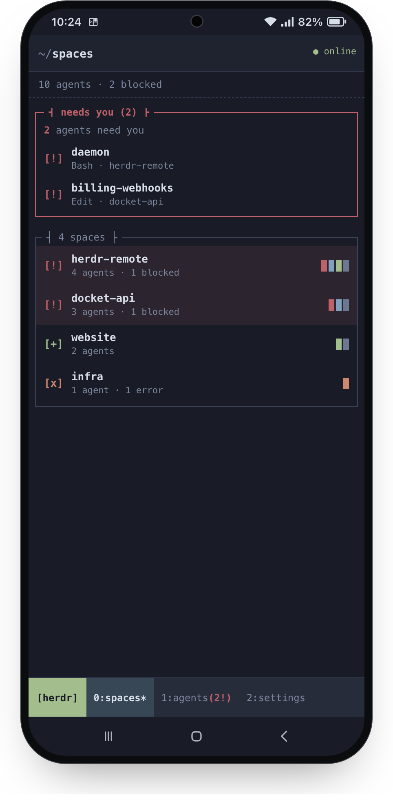
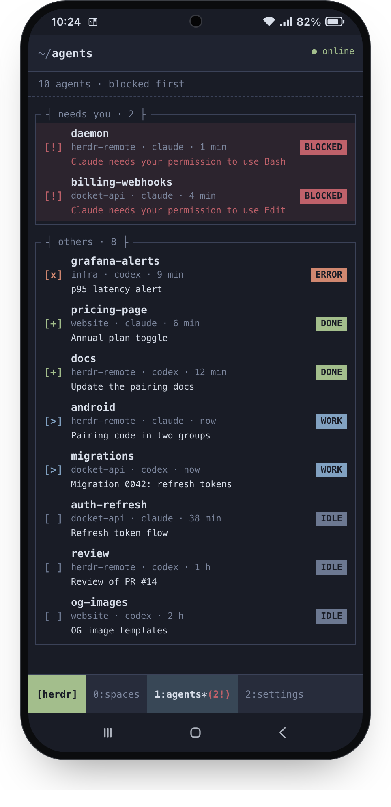
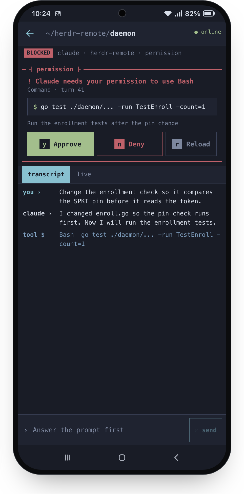
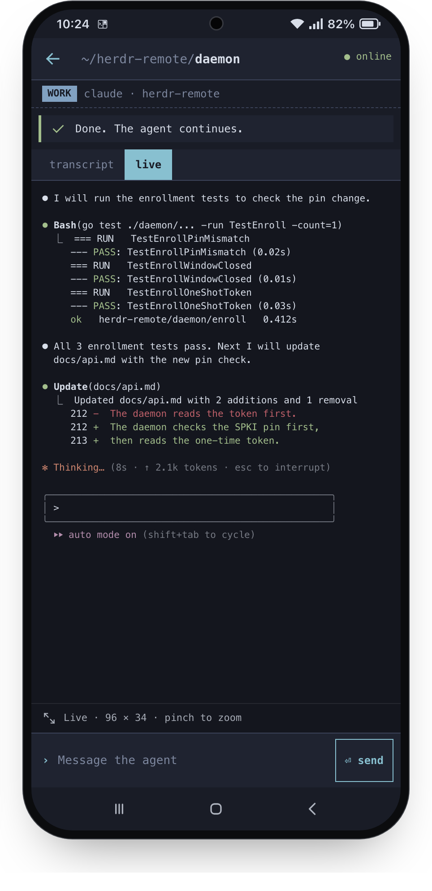
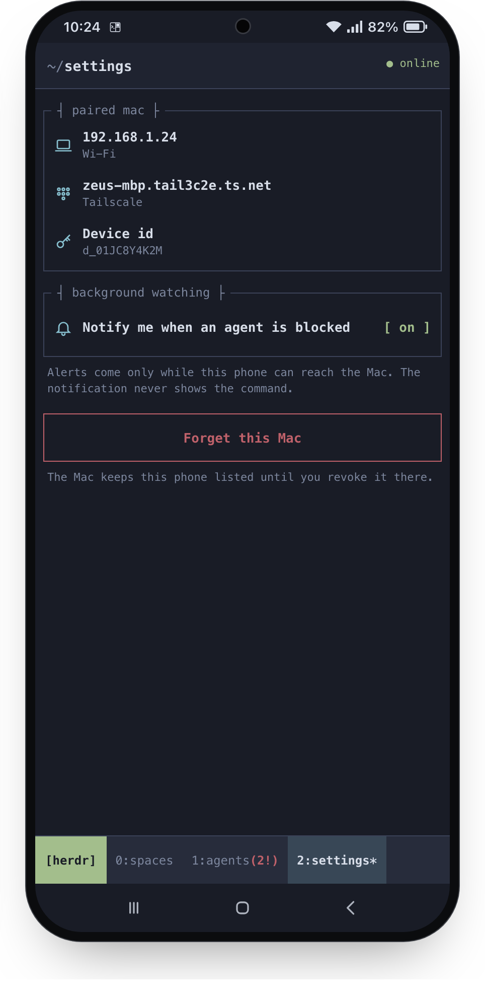
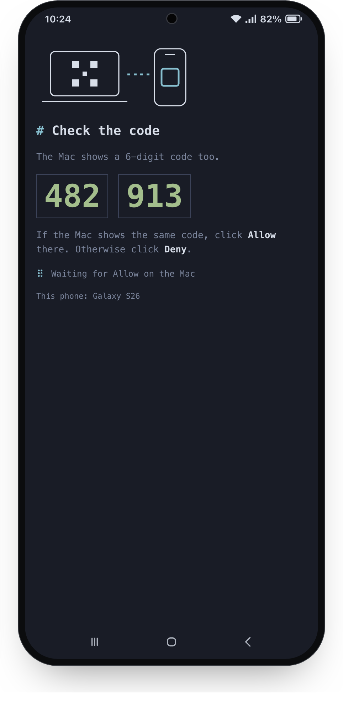

<p align="center"></p>

# herdr-remote

herdr-remote lets you watch and unblock the coding agents in Herdr.app on your Mac from an Android phone. The phone talks over Wi-Fi or Tailscale to a small daemon on the Mac, with mutual TLS and no relay server.

## Screens

<table>
  <tr>
    <td align="center"><br>Spaces</td>
    <td align="center"><br>All agents</td>
    <td align="center"><br>Approve a command</td>
  </tr>
  <tr>
    <td align="center"><br>Live view</td>
    <td align="center"><br>Settings</td>
    <td align="center"><br>Pairing code</td>
  </tr>
</table>

These are screens from the Pane design, rendered from [`design/viewer.html`](design/viewer.html). The app sets `FLAG_SECURE`, so real screenshots are black.

## Prerequisites

- **Mac:**
  - macOS on Apple silicon, with Homebrew
  - Herdr.app 0.1.13 or later, with `hc` and `herdr-app` on the `PATH`
  - Go 1.23 or later
  - Java 17: `brew install openjdk@17`
- **Phone:**
  - Android 12 or later, with Google Play services
  - USB debugging on
- **Optional:** Tailscale on the Mac and the phone, for access away from home.

## Set up

### 1. Install the daemon and the mod

1. From the repo root, run the install script:

   ```sh
   scripts/install.sh
   ```

2. If macOS asks to allow incoming connections for `herdr-remoted`, click Allow.
3. Check that the daemon runs:

   ```sh
   launchctl print gui/$(id -u)/dev.herdr-remote | grep state
   ```

The script builds `~/.local/bin/herdr-remoted`, loads the LaunchAgent `dev.herdr-remote` and installs the Herdr mod.

### 2. Build and install the app

1. Install the Android SDK, Gradle and an emulator image:

   ```sh
   scripts/setup-android.sh
   ```

2. Build the APK:

   ```sh
   cd android
   JAVA_HOME=/opt/homebrew/opt/openjdk@17 \
     ANDROID_HOME=/opt/homebrew/share/android-commandlinetools \
     ./gradlew assembleDebug
   ```

3. Connect the phone with USB, then install the APK:

   ```sh
   /opt/homebrew/share/android-commandlinetools/platform-tools/adb install -r \
     app/build/outputs/apk/debug/app-debug.apk
   ```

### 3. Pair the phone

1. Open the overlay in Herdr:

   ```sh
   herdr-app do mod.open --name herdr-remote
   ```

2. Click **Pair a phone**. A QR code shows for 120 s.
3. Open the app on the phone and scan the QR code.
4. If the 6-digit code on the phone matches the code on the Mac, click **Allow**. If not, click **Deny**.

### 4. Optional

- For full Codex transcripts, set Herdr's Codex launcher to `["codex", "--no-daemon"]` in Herdr settings (`new-menu.agents`).
- For access away from home, sign in to Tailscale on both devices before you pair.

## More

- [`docs/`](docs/README.md): the product, the architecture, the decisions (ADRs), the API, deployment, operations and testing.
- [`AGENTS.md`](AGENTS.md): the build, test and format commands, and the conventions for this repo.
