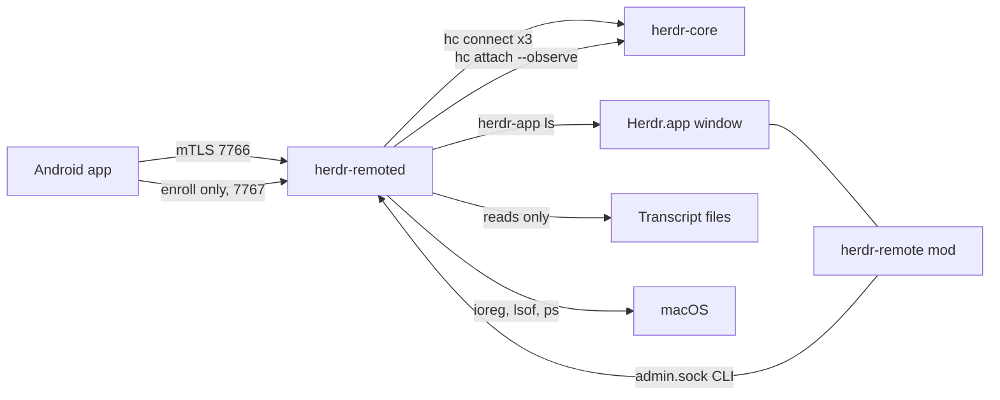
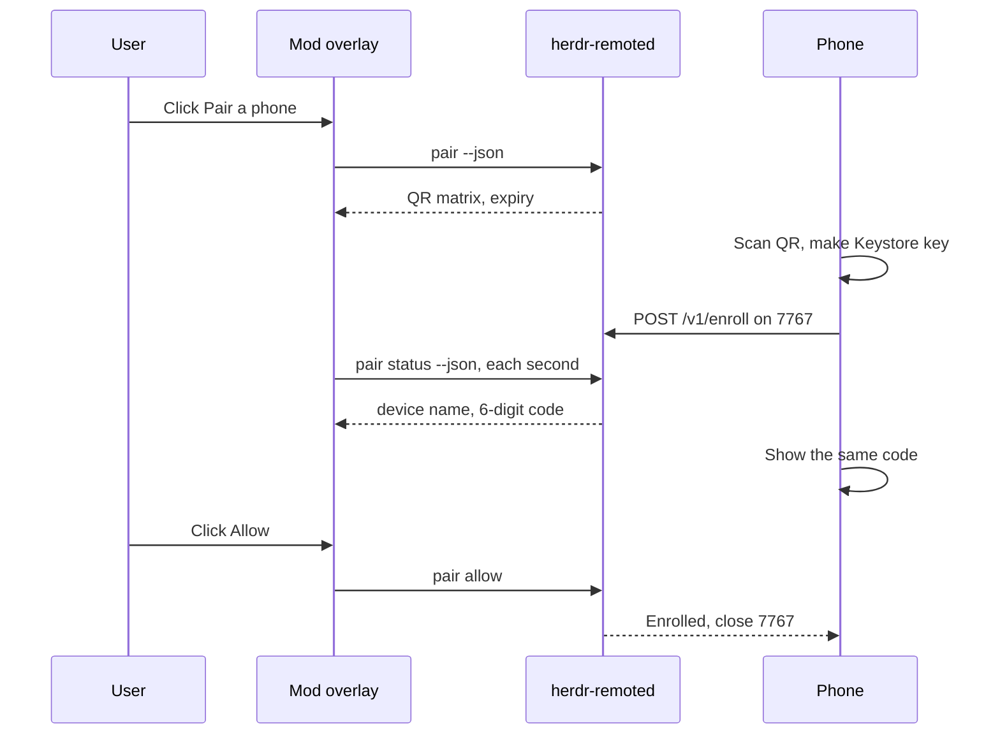
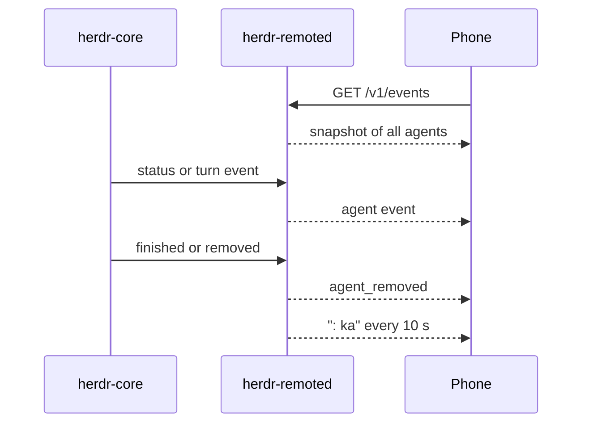
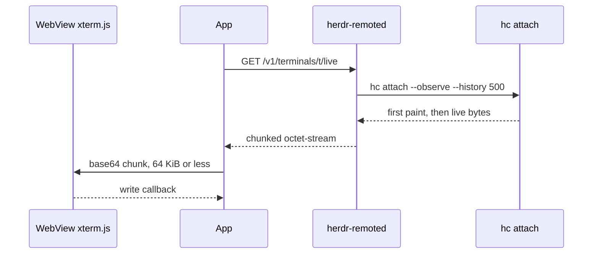
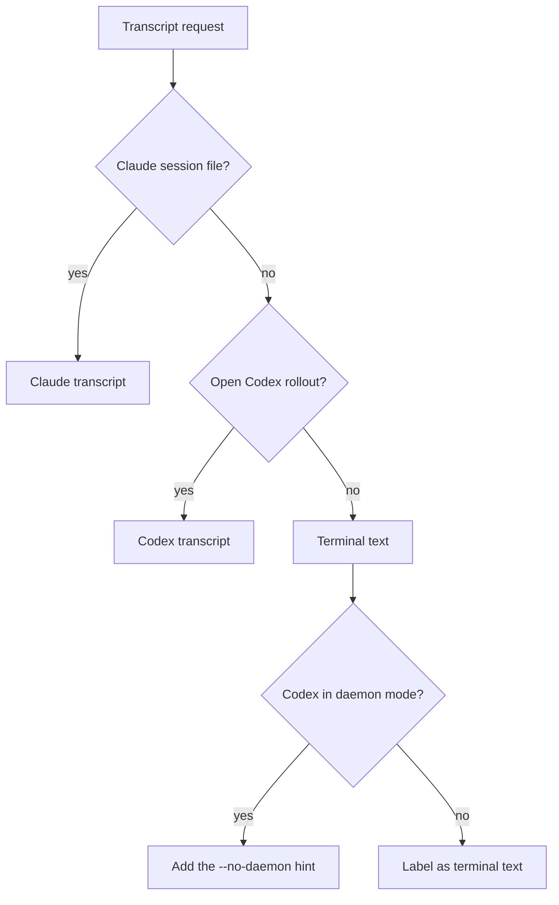
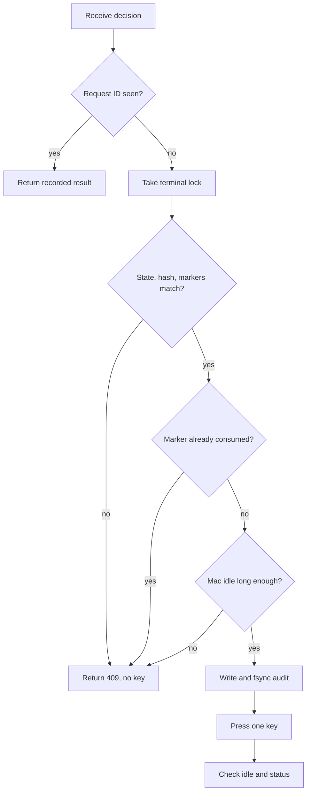

# Architecture

herdr-remote lets an Android phone watch and unblock the agents that run in Herdr.app on one Mac. It has three parts. The phone can reach only the daemon.

- **Status:** as built on `main`, 2026-11-10.
- **Decisions:** each design choice has an ADR in [`adr/`](README.md#decisions-adr).
- **Related:** [API](api.md), [Herdr and agent interfaces](interfaces.md), [deployment](deployment.md), [product requirements](product.md).

## 1. Components

This diagram shows the parts and the calls between them.

| Component          | Source              | Runs as                                        | Job                                                                                    |
| ------------------ | ------------------- | ---------------------------------------------- | -------------------------------------------------------------------------------------- |
| `herdr-remoted`    | `daemon/` (Go)      | LaunchAgent `dev.herdr-remote`, one per user   | The only network listener. Serves the API over mutual TLS. Reaches Herdr through `hc`. |
| `herdr-remote` mod | `mod/herdr-remote/` | JavaScript in Herdr.app, shown as an overlay   | Lists the paired phones, shows the pairing QR code, asks the user to Allow or Deny.    |
| Android app        | `android/` (Kotlin) | Package `dev.herdrremote`, Android 12 or later | Pairs, lists spaces and agents, shows transcripts and the live view, approves, sends.  |

- The phone reaches only the daemon, on two ports ([ADR 0004](adr/0004-two-tls-listeners.md)).
- The daemon reaches herdr-core through `hc connect` and `hc attach --observe`, never through the socket directly ([ADR 0002](adr/0002-hc-subprocesses-and-helper.md)).
- The mod runs inside Herdr.app. It calls the daemon CLI, which talks to the daemon through `admin.sock`.
- There is no relay, push service, server or database ([ADR 0013](adr/0013-background-alerts.md)).

## 2. Daemon

### 2.1 Source files

| File                 | Content                                                                    |
| -------------------- | -------------------------------------------------------------------------- |
| `main.go`            | The CLI: `serve`, `pair`, `devices`, `version`.                            |
| `daemon.go`          | Start, `config.json`, the two listeners, the device check on each request. |
| `run.go`             | The subprocess helper. The closed set of programs the daemon may start.    |
| `hc.go`              | The three `hc connect` connections and the allowed methods.                |
| `idle.go`            | `MacIdle()`: parses `HIDIdleTime` from `ioreg`.                            |
| `tls.go`             | The server key and certificate, and the TLS settings.                      |
| `devices.go`         | The device store, `devices.json`.                                          |
| `pair.go`            | The pairing window, the token and port 7767.                               |
| `admin.go`           | `admin.sock`: one JSON request line and one reply for each CLI call.       |
| `audit.go`           | `audit.log`, its rotation and the reload of request IDs and markers.       |
| `api.go`, `state.go` | The read endpoints, the agent and space state, and the SSE stream.         |
| `live.go`            | The live view: one `hc attach --observe` subprocess for each stream.       |
| `transcript.go`      | The transcript sources and pages.                                          |
| `actions.go`         | The prompt, decision and message endpoints, and the approval guard.        |

### 2.2 Access to Herdr

- The daemon keeps three long-lived `hc connect` subprocesses ([ADR 0002](adr/0002-hc-subprocesses-and-helper.md)):
  - **reads:** `terminal.list`, `terminal.get`, `terminal.read`
  - **events:** `events.subscribe`. A subscribed connection carries only notifications.
  - **actions:** `terminal.send` and `terminal.keys`. They wait until nobody types at the Mac, so they must not block reads.
- The daemon starts every other program through one helper in `run.go`:
  - It accepts only `hc`, `herdr-app`, `lsof`, `ps`, `ioreg` and `tailscale`, at absolute paths found at start.
  - It uses fixed argument shapes, no shell and a timeout.
  - It runs each program with a bare environment: `HOME`, `PATH=/usr/bin:/bin` and `LANG`. So the daemon never inherits `HC_TERMINAL_ID`, and its sends stay untagged.
- The allowed hc use is fixed in the code ([ADR 0003](adr/0003-allowed-hc-use.md)):
  - `hello`, `terminal.list`, `terminal.get`, `terminal.read`, `events.subscribe`
  - `terminal.send` with `force: false` and no `caller`
  - `terminal.keys` with exactly one key, `1` to `9`, `y`, `esc` or `tab`, from the approval code only ([ADR 0021](adr/0021-answer-questions.md))
  - `hc attach --observe`.
- A target must match `^t[0-9a-z]+$` (no `machine/` prefix), be `live`, and have `reported: true`. Each check fails toward a refusal.

### 2.3 Spaces and agents

- An agent is a live local terminal with `reported: true` ([ADR 0016](adr/0016-spaces-and-agents.md)).
- `/v1/spaces` runs `herdr-app ls` on each request. The daemon also runs it on `created`, `removed` and `labels` events, because a space rename causes no hc event.
- The daemon drops spaces whose `machine` is set. Remote machines are out of scope.
- The space of an agent comes from `herdr-app ls`, or else from its `herdr.space` label.
- In `herdr-app ls`, `sub_agents` is a list of terminal addresses. The daemon puts hidden children in the space and tab of their parent.
- If Herdr.app is not open, `/v1/spaces` returns one space `{id: "closed", name: "Herdr window closed"}` with every agent, sorted by `where`. Then `agent.space` and `agent.tab` come from the `where` label.
- Agents in no space go under `{id: "other", name: "Not in a space"}`.

## 3. Data flows

### 3.1 Pairing

This sequence shows how a new phone becomes a paired device ([ADR 0006](adr/0006-pairing.md)).

The rules:

1. The user opens the overlay with `herdr-app do mod.open --name herdr-remote`. The same command closes it. The overlay shows the paired devices, with Revoke for each one.
2. **Pair a phone** runs `herdr-remoted pair --json`. The daemon opens a 120 s window and port 7767. It returns `{matrix, expires_at, text}`:
   - `matrix` is the QR code as rows of `"0"` and `"1"` strings. The QR library is `github.com/skip2/go-qrcode`, error level M, no border.
   - `text` is the QR content. The emulator has no camera, so the app also has a field to paste the pairing link.
3. The overlay draws the matrix as run-length `div()` segments for each row, with a 4-cell quiet zone. It shows the expiry as a clock time. It writes no file and does not redraw on a timer.
4. The QR content is a pairing link. [API: pairing link](api.md#pairing-link) gives the format.
   - `ep` lists the private IPv4 addresses of active interfaces, any `100.64.0.0/10` address, and the MagicDNS name if `tailscale status --json` gives one.
   - The token is 32 random bytes, kept in memory only.
5. The phone makes a P-256 key in Android Keystore. It calls `POST /v1/enroll {token, name}` on 7767.
   - `name` must be 1 to 64 printable characters.
   - The token binds to the first client SPKI that uses it. The daemon refuses other SPKIs. It accepts the same SPKI again, so the phone can retry.
   - The call long-polls until Allow, Deny or expiry.
6. Before the long-poll, the phone makes one pinned TLS handshake with port 7767 to read the server key. So the phone knows the 6-digit code before Allow.
7. The overlay polls `herdr-remoted pair status --json` each second. Each call returns at once. The overlay redraws only when the state changes.
8. The overlay and the phone both show a 6-digit code. Both sides make it the same way:
   1. Take SHA-256 of the server SPKI DER, then the client SPKI DER.
   2. Read the first 4 bytes as a big-endian unsigned integer.
   3. Take it mod 1,000,000, with leading zeros to 6 digits.

   `testdata/pairing-vectors.json` holds test vectors that the Go and the JVM tests share.

9. Allow (`pair allow`) stores the device. Deny (`pair deny`), Cancel, a closed overlay (`pair cancel`) or expiry stores nothing. Then the window and port 7767 close.
10. The mod calls the daemon by the absolute path that `install.sh` writes into `main.js`.

### 3.2 Events and lists

This sequence shows how a status change on the Mac reaches the phone.

- The daemon subscribes once with `events.subscribe` and keeps the agent state in memory.
- The phone holds one SSE connection with a 30 s read timeout. A silent connection is dead, so the phone reconnects ([ADR 0005](adr/0005-http-sse-and-streams.md)).
- On each SSE connect, the phone also calls `/v1/hello` to refresh the endpoint list and the clock offset.
- On `missed`, the daemon takes a fresh snapshot and sends a new `snapshot` event. The daemon treats any notification whose params carry a `terminals` list as a snapshot.
- The phone reducer applies `snapshot`, `agent` and `agent_removed`. Lists sort blocked agents first.
- A stale view shows its age in a banner: "Not connected to the Mac: last update N s ago".

### 3.3 Live view

This sequence shows one live view ([ADR 0008](adr/0008-live-view.md)).

- The daemon copies stdout of `hc attach --observe` to the response and flushes each read. `attach` never types and never resizes.
- The phone shows xterm.js 5.x in a WebView at the terminal's own `cols` and `rows`, scaled to the screen width, with pinch zoom.
- **Flow control:**
  - Kotlin sends base64 chunks of at most 64 KiB.
  - Each chunk waits for the xterm.js `write` callback before the next one.
  - At more than 1 MiB pending, Kotlin drops the queue and reopens the stream. A fresh `attach` gives a fresh paint, so the drop loses nothing on the screen.
- **Stream end:** a stream ends on a client disconnect, on a `size` event for the terminal, or on a revoke. Each end kills its subprocess. The phone reopens a stream when it ends and on each SSE reconnect.
- **Limit:** a device can have at most 2 live views. The third gets 409 `live_limit`.
- The live view has no read timeout, because an idle terminal sends no bytes.

### 3.4 Transcripts

This flow shows how the daemon picks the transcript source for an agent ([ADR 0009](adr/0009-transcripts.md)).

The sources, in order. Each one is an exact identity:

1. **Claude:** `foreground.pid` leads to `~/.claude/sessions/<pid>.json`, then `sessionId`, then the single match of `~/.claude/projects/*/<sessionId>.jsonl`.
2. **Codex with `--no-daemon`:** the daemon walks the child processes of `foreground.pid` with `ps` to the process named `codex`. It runs `lsof -Fn -p <pid>` and keeps the open `~/.codex/sessions/**/rollout-*.jsonl` files. It uses the one whose `session_meta` has no `parent_thread_id`.
3. **Terminal text:** `terminal.read` with `lines: 2000`, labelled "terminal text". While the agent works or is blocked, this is the visible screen only. For a Codex in daemon mode, the response has the hint "Start Codex with `--no-daemon` for the full transcript".

The rules:

- The real path (after symlinks) must be under `~/.claude/projects` or `~/.codex/sessions`.
- A page is a byte range of at most 2 MiB, read back from the end. A page that starts inside the file drops all bytes up to the first newline.
- A record longer than one page shows as `[record too large]`. The next cursor skips that record. A partial last line is ignored.
- The cursor is `{file, inode, offset}`, encoded as opaque base64. A cursor for a different file returns 409 `cursor`. The phone then starts again from the end.
- A read error, or a file with no record that parses, falls back to terminal text.
- The first request pages back until it has an item.
- Tool calls and tool results are cut to 2000 characters. Thinking blocks are not sent.
- The daemon skips these records:
  - Claude `isMeta` records
  - Codex `developer` messages
  - user messages that start with `# AGENTS.md instructions` or `<environment_context>`.
- The daemon shows Codex `function_call` records like `custom_tool_call` records.

### 3.5 Approvals

This flow shows the order of the checks for one decision ([ADR 0010](adr/0010-approval-guard.md)).

The rules, in order. The comments in `daemon/actions.go` use these rule numbers.

1. The approval applies only when `state = blocked`, and either `kind = permission` with `app` `claude-code` or `codex`, or `kind = question` with `app` `claude-code` ([ADR 0021](adr/0021-answer-questions.md)). Other prompts are view-only ([ADR 0011](adr/0011-view-only-prompts.md)). Approve and deny need a permission. An answer needs a question.
2. `GET /prompt` returns `block` and `prompt_hash`:
   - `block` is the screen region from the line that starts the dialog (`Do you want` or `Would you like`) to the line with `Esc to cancel` or `Press enter to confirm`. It keeps the leading spaces of the screen and trims trailing spaces.
   - For a question, `block` goes from the question tabs to the end of the screen, without the rule lines. `options` lists its numbered options and, after a multi-select, `tab`.
   - `prompt_hash` is SHA-256 of `app`, `turn`, `msg` and `block`, each followed by a NUL byte.
3. `POST /decision` checks `request_id` first:
   - An ID whose UUIDv7 time is more than 5 minutes from the daemon clock returns 409 `expired_request`.
   - A known ID returns its recorded result, whatever the body.
   - An ID with a `dispatching` line and no result line returns `outcome_unknown`.
4. Under a per-terminal lock, the daemon reads `terminal.get` and `terminal.read(lines 0)` again. It requires all of these:
   - the same state, kind, app and turn
   - the same `prompt_hash`
   - the option markers on the screen. Claude: `1. Yes` and `Esc to cancel`. Codex: `Yes, proceed (y)` and `(esc)`. A question: options that count from 1, and `Esc to cancel` or `Submit answers`.
   - for an answer, a `key` that is one of the fresh options. If not, the daemon returns 400.
   - a consumed marker for the terminal that is not already `{turn, prompt_hash}`.
5. **The Mac-in-use guard (a heuristic), the last check:**
   - If `HIDIdleTime` is less than `mac_idle_seconds` (default 10), the daemon returns 409 `mac_in_use` with `idle_ms` and audits the refusal. A value of 0 turns the guard off.
   - If `ioreg` fails, or its output does not parse, the daemon refuses (fail closed).
   - The guard sees local keyboard and mouse input. It does not see SSH sessions, or `hc send` and `hc keys` from other terminals and agents. hc's 3 s quiet rule covers those. Remote-desktop input is not verified.
6. The daemon appends `{action: decision, state: dispatching, request_id, terminal, turn, prompt_hash, decision}` to `audit.log` and fsyncs it. If the write fails, it returns 503 and presses no key.
7. The daemon sets the consumed marker and presses one key: Claude `1` or `esc`, Codex `y` or `esc`, or the answer's `key`. It waits up to 120 s for `terminal.keys`, because hc holds a key while someone types at the Mac.
8. The daemon reads `HIDIdleTime` again:
   - If the new idle time is less than the time since the idle check in rule 5, the Mac had input during the call. The result is `uncertain`.
   - If not, the daemon reads the prompt for up to 3 s. The result is `applied` if the status, the turn or the prompt hash moved, or `sent_unconfirmed` if not. A question stays blocked between its steps, so the hash shows that the key landed.
9. The daemon appends the result line. It never presses a key again for that request.
10. Retention:
    - The daemon keeps every accepted request ID for 10 minutes. That is longer than the 5-minute window in which an ID is valid.
    - It keeps the consumed marker of a terminal until the terminal's turn changes or the terminal ends.
    - On start, it rebuilds both from the last 10 minutes of `audit.log` and `audit.log.1`.
    - The rate limit (2 actions a second for each device) keeps 10 minutes of audit lines far below the 10 MiB rotation size. So a rotation cannot drop a valid ID.

More rules:

- A decision or a message continues on a detached context after the phone drops the connection. So a retry with the same `request_id` gets the real result.
- The daemon does not remember a refused request (409 or 400), so the phone can retry it. It remembers a dispatched request for 10 minutes.
- `request_id` is a UUIDv7 that the phone makes for each user action. The phone sets its time from its own clock plus the offset to `server_time_ms` from `/v1/hello`. So clock skew does not matter.

### 3.6 Messages

- `POST /message {request_id, text}` calls `terminal.send` with `force: false` and no `caller`, so the text arrives as a plain prompt ([ADR 0012](adr/0012-messages.md)).
- Targets are live terminals with `reported: true`. A blocked agent refuses the message with 409 `blocked`.
- The daemon removes C0 and C1 control characters, but keeps `\n` and `\t`. The limit is 4000 characters.
- A fsynced `dispatching` audit line `{request_id, terminal, length}` comes first. It has the text length, never the text or a hash of it. If the write fails, the daemon returns 503 and sends nothing.
- Delivery is at most once for each `request_id`. The request ID rules of [section 3.5](#35-approvals) apply.

## 4. Android app

### 4.1 Code

| Package or file              | Content                                                                                       |
| ---------------------------- | --------------------------------------------------------------------------------------------- |
| `MainActivity.kt`, `Gate.kt` | The single activity, the blank recents card, and the app lock.                                |
| `HerdrRemoteApp.kt`          | Process-wide objects. No DI framework.                                                        |
| `net/`                       | The Keystore key, the pinned TLS client, the API, the pairing link, UUIDv7, the store.        |
| `watch/`                     | The SSE repository, the reducer, the watch service and the boot receiver.                     |
| `ui/`                        | The screens and view models. Screens are a `Screen` sealed class, with no navigation library. |
| `ui/theme/`                  | The Pane design system. See [design](design.md).                                              |
| `assets/xterm/`              | xterm.js, `live.html`, and the terminal palette.                                              |

The stack ([ADR 0015](adr/0015-android-stack.md)), with minSdk 31 and targetSdk 35:

- Kotlin and Jetpack Compose
- OkHttp for TLS, SSE and streams
- kotlinx.serialization
- the Google Play services code scanner (no camera permission)
- androidx.biometric
- xterm.js 5.x as a bundled asset.

### 4.2 Screens

| Screen     | Content                                                                                                                                                                                                                                                               |
| ---------- | --------------------------------------------------------------------------------------------------------------------------------------------------------------------------------------------------------------------------------------------------------------------- |
| Lock       | The app icon, the name and Unlock. No agent data.                                                                                                                                                                                                                     |
| Pair       | Code scanner or a pasted link, the 6-digit code, a wait for Allow.                                                                                                                                                                                                    |
| Spaces     | Agents that need the user, then the spaces with agent counts and the most urgent status.                                                                                                                                                                              |
| Space      | Agents in the space, with status and tab name.                                                                                                                                                                                                                        |
| All agents | Every agent. Blocked agents first.                                                                                                                                                                                                                                    |
| Agent      | Tabs: Transcript, Live. A prompt card with Approve and Deny, or a key for each option of a question. A message box with a skill list after "/".                                                                                                                       |
| Transcript | The model in the header. It follows new items while the end shows, with a Bottom button. It reloads the last page at once and then each 1 s while the agent works. A spinner row at the end shows the seconds since the last item. A long press selects text to copy. |
| Settings   | Paired Mac, background watching, Forget this Mac.                                                                                                                                                                                                                     |

### 4.3 Key and TLS client

- **Key (Android Keystore):** P-256, `PURPOSE_SIGN`, digests `SHA256` and `NONE`, `setUserAuthenticationRequired(false)`, not bound to an unlocked device ([ADR 0014](adr/0014-phone-key-and-privacy.md)). The chain is the self-signed certificate that Keystore makes: CN=herdr-remote, valid for ten years.
- **TLS client:**
  - An `X509KeyManager` returns the Keystore alias, its private key and its chain.
  - An `X509TrustManager` and a `HostnameVerifier` both accept only a leaf certificate whose SPKI SHA-256 equals the pin. Certificate names and IP addresses play no part.
  - An OkHttp `ConnectionSpec` allows TLS 1.3 only.
- **Endpoints:**
  - The app remembers the last endpoint that worked and tries the others in order.
  - `/v1/hello` refreshes the list. The last endpoint that worked stays first, also when the list no longer names it. The emulator reaches the Mac only as `10.0.2.2`.

### 4.4 Actions

- The action read timeout is 150 s. Action calls set `retryOnConnectionFailure(false)`.
- An action changes endpoint only if the connection failed before the request was sent. After that, the app never retries.
- Any failure that is not an explicit daemon reply shows "Outcome unknown. Check the transcript before you send again".
- The prompt refresh after a decision does not replace that note.
- After `expired_request`, the app calls `/v1/hello` to correct its clock. It does not post again.
- Messages work only in the unlocked app. Approve and Deny work in the unlocked app and in an alert on an unlocked phone ([ADR 0019](adr/0019-alert-preview-and-actions.md)).

### 4.5 Live view WebView

- JavaScript is on. `WebViewAssetLoader` serves the bundled assets.
- Every other request is blocked. File and content access are off.
- The page receives bytes only. It never sends input.
- The terminal background `#14161E` shows behind the WebView and in it before the page paints.

### 4.6 Background watching

- The watch service is an opt-in foreground service that holds `/v1/events` ([ADR 0013](adr/0013-background-alerts.md)). It posts the ongoing notification "Herdr Remote is watching" once and never updates it.
- It shows one notification for each blocked episode. An episode starts when an agent becomes blocked, or shows another `msg` while blocked. The turn is not part of the episode, because hc sends the turn after the blocked status.
- The blocked alert shows the prompt and has Approve and Deny ([ADR 0019](adr/0019-alert-preview-and-actions.md)). A turn change in the same episode updates it quietly, because the prompt hash holds the turn.
- An agent that stops working (`done`, `idle` or `error`) gives one alert on the channel "Agent finished".
- Each agent has one notification. A new alert replaces the last one.
- A locked phone, and so a mirrored watch, shows only the agent name and what it needs, with no prompt and no buttons.
- After a reconnect, the snapshot shows the agents that are still blocked.
- Alerts come only while the service runs and is connected.
- **Manifest:**
  - Permissions: `INTERNET`, `FOREGROUND_SERVICE`, `FOREGROUND_SERVICE_SPECIAL_USE`, `POST_NOTIFICATIONS`, `RECEIVE_BOOT_COMPLETED`, `REQUEST_IGNORE_BATTERY_OPTIMIZATIONS`, `USE_BIOMETRIC`.
  - The service has `android:foregroundServiceType="specialUse"` and the `PROPERTY_SPECIAL_USE_FGS_SUBTYPE` property.
  - `BOOT_COMPLETED` and `MY_PACKAGE_REPLACED` receivers start the service again if the toggle is on. The app also starts it each time it opens, because Android 17 can skip `MY_PACKAGE_REPLACED`.
- The app starts the service while it is in the foreground. It asks for an exemption from battery optimization.
- If notifications are denied, the toggle explains why and stays off.
- **Forget this Mac** cancels the event stream and stops the watch service. Then it clears the pairing.

### 4.7 App lock

- The app locks at start and after 5 minutes in the background. Then it asks for BiometricPrompt (a strong biometric or the device credential) before it shows anything.
- The application registers one observer on the process lifecycle. No activity owns it, so the lock also works after a swipe from recents.
- On a phone with no screen lock, the gate passes with a note.

## 5. Herdr mod

- Folder: `~/.config/herdr-app/mods/herdr-remote/`, with `mod.json` and `main.js`.
- `mod.json` opens a 440 by 600 dialog overlay.
- The overlay opens to the device list, with Revoke for each device.
- **Pair a phone** calls `pair --json`, draws the QR code and shows the expiry time.
- A `cx.spawn` loop with `cx.sleep(1000)` calls `pair status --json` each second. It calls `cx.notify()` only when the state changes, because each mod redraw redraws the full window.
- When a phone is pending, the overlay shows its name, the 6-digit code, Allow and Deny.
- Closing the overlay calls `pair cancel`.
- The mod also accepts the commands `herdr-remote.pair`, `.allow`, `.deny` and `.cancel` through `nextCommand()`. So a key binding or `herdr-app do herdr-remote.pair` can start a pairing.
- The mod writes no file. No `exec` call can reach the 30 s limit.

## 6. Security and privacy model

### 6.1 Trust boundary

- Programs that run as the same macOS user are trusted ([ADR 0018](adr/0018-trust-boundary.md)). They can already drive hc directly, read `server.key` and `devices.json`, or run `herdr-remoted pair allow`. File modes cannot stop them.
- The design protects against:
  - the network (the LAN and the tailnet)
  - leaked QR codes
  - lost phones
  - second phones and replays
  - hostile bytes in terminal output or transcripts.

### 6.2 Threats and controls

| Threat                                | Control                                                                                                                                                                                                    | Requirement |
| ------------------------------------- | ---------------------------------------------------------------------------------------------------------------------------------------------------------------------------------------------------------- | ----------- |
| A device on the network               | Port 7766 completes TLS only for a paired key. TLS 1.3, `RequireAnyClientCert`, no session tickets, checks in `VerifyConnection` ([ADR 0004](adr/0004-two-tls-listeners.md)).                              | SR-1        |
| A fake Mac                            | The phone pins the SPKI SHA-256 from the QR code. Certificate names play no part.                                                                                                                          | SR-3        |
| A leaked QR code                      | Port 7767 opens only in a 120 s window that the user starts. The token binds to one key. The user compares a 6-digit code and clicks Allow ([ADR 0006](adr/0006-pairing.md)).                              | SR-1        |
| A compromised phone app               | The daemon allows a fixed set of hc calls and keys (`1` to `9`, `y`, `esc`, `tab`), each behind the approval guard. No command, file or program access ([ADR 0003](adr/0003-allowed-hc-use.md)).           | SR-2        |
| A stolen phone key                    | The private key stays in Android Keystore.                                                                                                                                                                 | SR-4        |
| A lost phone                          | Revoke closes its connections and live views. A resumed TLS session fails ([ADR 0007](adr/0007-revocation.md)). The app lock asks for a biometric.                                                         | SR-5, SR-10 |
| A retry, a second phone, a replay     | UUIDv7 request IDs with a 5-minute window, a consumed marker, the audit log, a rate limit ([ADR 0010](adr/0010-approval-guard.md)).                                                                        | SR-6        |
| A prompt that changed under the user  | Turn, prompt hash and marker checks, the Mac-in-use guard, the `uncertain` result.                                                                                                                         | SR-7        |
| No record of what a phone did         | An audit line for each pairing event, revocation, decision, refusal and message ([ADR 0017](adr/0017-logging-and-audit.md)).                                                                               | SR-8        |
| Secrets or content in logs            | No log has tokens, codes, keys, transcript text, terminal bytes or message text.                                                                                                                           | SR-9        |
| Content on the lock screen or recents | A blank recents card ([ADR 0024](adr/0024-allow-screenshots.md)). Alerts on a locked phone show only the agent name and what it needs, with no prompt ([ADR 0019](adr/0019-alert-preview-and-actions.md)). | SR-11       |
| Content at rest on the phone          | Transcripts and terminal bytes stay in memory only.                                                                                                                                                        | SR-12       |
| Hostile terminal bytes                | The WebView loads only bundled files and cannot send input. The message filter removes control characters. Transcript paths must be under two roots.                                                       | SR-13       |

The SR numbers are the security requirements in [product.md](product.md#8-security-and-privacy-requirements).

### 6.3 Phone privacy

- The activity calls `setRecentsScreenshotEnabled(false)`, so the recents card shows no content. Screenshots are allowed. Before Android 13 it sets `FLAG_SECURE` instead ([ADR 0024](adr/0024-allow-screenshots.md)).
- Notifications use `VISIBILITY_PRIVATE`. The public version has only the title: the agent name and what it needs ([ADR 0019](adr/0019-alert-preview-and-actions.md)).
  - On a locked phone, the service also replaces each alert with its title only, with no prompt and no buttons. The default lock screen setting shows private text, so the public version alone is not enough.
  - On an unlocked phone, an alert shows the agent name and the prompt. Approve and Deny need the phone to be unlocked.
- Transcripts and terminal bytes stay in memory. No build logs content.

### 6.4 Residual risk

WARNING: A phone approval can land on a different prompt in rare cases. `terminal.keys` has no status condition, and the Mac-in-use guard is a heuristic.

- The guard does not see input over SSH, or input from other terminals and agents through hc. Remote-desktop input is not verified.
- Such input can change the screen first. Local input can also start in the milliseconds between the idle check and the key. In both cases, the key can land on another prompt.
- hc can hold an approval key for up to 120 s while someone types at the Mac. That is the window of the race.
- The daemon reports local input during the call as `uncertain` and audits it.
- No shipped hc API can remove this race.

Set `mac_idle_seconds` to 0 if a device such as a mouse jiggler keeps the Mac always "in use". [Operations: known issues](operations.md#known-issues) lists the other accepted issues.

## 7. Failure handling

| Case                               | Behaviour                                                                          |
| ---------------------------------- | ---------------------------------------------------------------------------------- |
| hc unavailable                     | The daemon returns 503 and reconnects. The phone shows the last data with its age. |
| `missed` event                     | The daemon takes a fresh snapshot.                                                 |
| Herdr.app closed                   | Agents are grouped by `where`.                                                     |
| Transcript missing or bad          | The next source, ending at terminal text.                                          |
| Endpoint unreachable               | The phone tries the next endpoint and remembers the last good one.                 |
| Size change                        | The live stream starts again.                                                      |
| Device revoked during a stream     | The daemon closes the stream.                                                      |
| Guard failure, or Mac in use       | 409 with a reason.                                                                 |
| Audit write failure                | 503, no key, no send.                                                              |
| SSE silent for 30 s                | The phone reconnects and reopens live views.                                       |
| Live backlog over 1 MiB            | The phone reopens the stream.                                                      |
| Transcript cursor for another file | 409, and the phone starts from the end.                                            |
| Notifications denied               | Background watching stays off, with an explanation.                                |

## 8. Constraints

- Herdr is closed source. The design uses only its shipped interfaces: `hc`, `herdr-app` and mods. It changes no shipped mod or setting.
- There is no relay. Away from home, the phone reaches the Mac over Tailscale.
- Codex agents give a full transcript only with `--no-daemon`. The user sets this once in Herdr's Codex launcher.
- The phone needs Google Play services for the code scanner.
- The macOS firewall can ask once to allow incoming connections to `herdr-remoted`.
- Some facts come from undocumented files and screens. [Interfaces: assumptions](interfaces.md#assumptions) lists them, with the fallback for each one.
