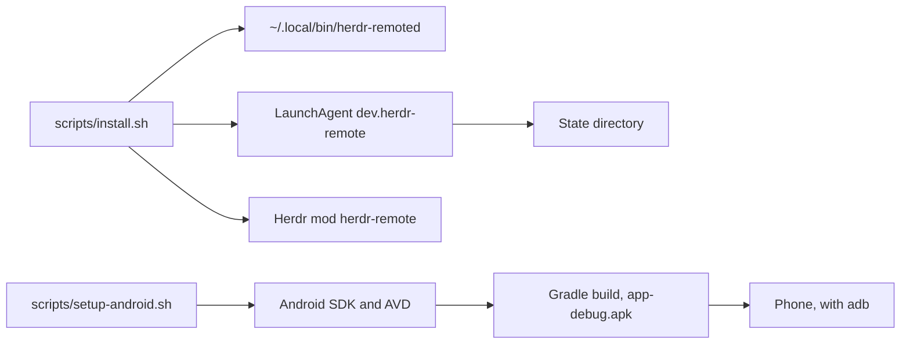

# Deployment

This page tells how to install, pair and update herdr-remote on one Mac and one or more Android phones. The [README](../README.md) has the short version.

## What goes where

This diagram shows what each script installs.



| Item        | Path                                                |
| ----------- | --------------------------------------------------- |
| Daemon      | `~/.local/bin/herdr-remoted`                        |
| LaunchAgent | `~/Library/LaunchAgents/dev.herdr-remote.plist`     |
| State       | `~/Library/Application Support/herdr-remote/`       |
| Mod         | `~/.config/herdr-app/mods/herdr-remote/`            |
| Android SDK | `/opt/homebrew/share/android-commandlinetools`      |
| APK         | `android/app/build/outputs/apk/debug/app-debug.apk` |

## Prerequisites

- **Mac:**
  - macOS on Apple silicon, with Homebrew.
  - Herdr.app 0.1.13 or later, with `hc` and `herdr-app` on the `PATH`.
  - Go 1.23 or later.
  - Java 17 (`brew install openjdk@17`) for the Android build.
  - Tailscale, for access away from home.
- **Phone:**
  - Android 12 (API 31) or later, with Google Play services.
  - USB debugging on, for `adb install`.
  - Tailscale, for access away from home.

## Install the daemon and the mod

1. Run the install script from the repo:

   ```sh
   scripts/install.sh
   ```

2. If macOS asks to allow incoming connections for `herdr-remoted`, click Allow.
3. Check that the daemon runs:

   ```sh
   launchctl print gui/$(id -u)/dev.herdr-remote | grep state
   ```

`install.sh` does these steps:

1. It builds the daemon from `daemon/` to `~/.local/bin/herdr-remoted`.
2. It writes the LaunchAgent plist (see [LaunchAgent](#launchagent)).
3. It runs `launchctl bootout` for the old service and waits until it is gone. Then it runs `launchctl bootstrap gui/$(id -u)` on the plist. `bootstrap` fails with EIO until the old service is gone.
4. It copies the mod to `~/.config/herdr-app/mods/herdr-remote/`:
   - It writes the absolute daemon path into `main.js` in place of `__HERDR_REMOTED__`.
   - It writes the hidden marker file `.herdr-remote-owned`.
   - If the folder exists without the marker, the script stops with an error. The folder belongs to someone else.
   - `HERDR_APP_HOME` changes the Herdr config folder, if it is set.
5. It runs `herdr-app check` on the copied mod.
6. It prints the firewall note and the Codex tip. It changes no Herdr setting and no other mod.

## LaunchAgent

- **Label:** `dev.herdr-remote`.
- **Program:** `~/.local/bin/herdr-remoted serve`.
- **Keys:** `RunAtLoad` and `KeepAlive`. launchd starts the daemon at login and again after a crash.
- **Output:** `StandardOutPath` and `StandardErrorPath` are `daemon.log` in the state directory.

Useful commands:

| Task               | Command                                                |
| ------------------ | ------------------------------------------------------ |
| Show the state     | `launchctl print gui/$(id -u)/dev.herdr-remote`        |
| Restart the daemon | `launchctl kickstart -k gui/$(id -u)/dev.herdr-remote` |
| Stop the daemon    | `launchctl bootout gui/$(id -u)/dev.herdr-remote`      |
| Start it again     | `scripts/install.sh`                                   |

## State files

The state directory is `~/Library/Application Support/herdr-remote/` (mode 0700).

WARNING: Do not print, copy or commit `server.key`. It is the identity of the Mac. A copy lets a program act as the daemon to every paired phone.

| File           | Mode | Content                                                                                                              |
| -------------- | ---- | -------------------------------------------------------------------------------------------------------------------- |
| `server.key`   | 0600 | P-256 private key.                                                                                                   |
| `server.crt`   | 0644 | Self-signed, valid for ten years, subject `CN=herdr-remoted`.                                                        |
| `devices.json` | 0600 | `[{id, name, spki_sha256, added}]`, written atomically (temporary file, then rename).                                |
| `admin.sock`   | 0600 | Socket for the CLI commands.                                                                                         |
| `audit.log`    | 0600 | JSON lines. Rotates at 10 MiB to `audit.log.1`.                                                                      |
| `daemon.log`   | 0600 | LaunchAgent stdout and stderr. The daemon rotates it at 10 MiB and sets it to 0600 at start (launchd makes it 0644). |
| `config.json`  | 0600 | Optional. `{"mac_idle_seconds": 10}`.                                                                                |

- The start line in `daemon.log` prints the server pin. The pin is the public key hash from the QR code, not a secret.
- `mac_idle_seconds` is the Mac-in-use guard: the daemon refuses an approval if the Mac had input in the last N seconds. 0 turns the guard off. Restart the daemon after a change.
- If `server.key` is lost, the daemon makes a new one. Then every phone must pair again, because the pin changes.

## Network

| Port | Use                                | Open                               |
| ---- | ---------------------------------- | ---------------------------------- |
| 7766 | The API, for paired phones only    | Always                             |
| 7767 | Enrollment, `POST /v1/enroll` only | Only during a 120 s pairing window |

- The phone connects over the LAN, or over Tailscale away from home. It uses the same pairing for both, because it pins the key, not an address.
- The QR code lists the endpoints:
  - the private IPv4 addresses of the active interfaces
  - any Tailscale address (`100.64.0.0/10`)
  - the MagicDNS name, if `tailscale status --json` gives one.
- The phone learns new Mac addresses from `/v1/hello`, only while it is connected. Without Tailscale, a new Wi-Fi address on the Mac needs a new pairing.

### Tailscale

1. Install Tailscale on the Mac and on the phone.
2. Sign in to the same tailnet on both.
3. Pair the phone after Tailscale runs on the Mac, so the QR code lists the Tailscale address.

## Codex transcripts

Codex gives a full transcript only with `--no-daemon`. Herdr's own Codex launcher runs plain `codex`.

1. Open Herdr settings.
2. Set the Codex launcher in `new-menu.agents` to `["codex", "--no-daemon"]`.

Without this setting, a Codex agent shows terminal text, with a hint to start Codex with `--no-daemon`. `install.sh` does not change Herdr settings.

## Build machine

The Android build runs on the same Mac, without Android Studio.

1. Install the Android toolchain:

   ```sh
   scripts/setup-android.sh
   ```

2. Add `adb` and the emulator to the `PATH`, as the script prints:

   ```sh
   export ANDROID_HOME=/opt/homebrew/share/android-commandlinetools
   export PATH="$ANDROID_HOME/platform-tools:$ANDROID_HOME/emulator:$PATH"
   ```

`setup-android.sh` does these steps:

1. `brew install --cask android-commandlinetools` and `brew install gradle`, if they are not installed.
2. `sdkmanager --licenses`.
3. `sdkmanager "platform-tools" "platforms;android-35" "build-tools;35.0.0" "emulator" "system-images;android-35;google_apis_playstore;arm64-v8a"`.
4. `avdmanager create avd -n herdr-remote` (pixel_6, Android 15, arm64), if the AVD does not exist.
5. It writes `sdk.dir` to `android/local.properties`.

Outside the repo, it changes only Homebrew packages and the SDK directory. The build uses Gradle wrapper 8.14.3, AGP 8.11.1, Kotlin 2.2.0 and Compose BOM 2025.06.01.

## Build and install the app

1. Build the debug APK:

   ```sh
   cd android
   JAVA_HOME=/opt/homebrew/opt/openjdk@17 \
     ANDROID_HOME=/opt/homebrew/share/android-commandlinetools \
     ./gradlew assembleDebug
   ```

2. Connect the phone with USB. Allow USB debugging on the phone.
3. Install the APK:

   ```sh
   adb install -r app/build/outputs/apk/debug/app-debug.apk
   ```

- The app is sideloaded. There is no Play Store release.
- Every build keeps the recents card blank. Screenshots of the app are allowed ([ADR 0024](adr/0024-allow-screenshots.md)). [Design](design.md) has the mockups.

## Pair a phone

CAUTION: Pair only a phone that you hold. Allow gives the phone access to approve and send prompts to every agent on the Mac.

1. Open the overlay in Herdr:

   ```sh
   herdr-app do mod.open --name herdr-remote
   ```

2. Click **Pair a phone**. A QR code shows, valid for 120 s.
3. Open the app on the phone and scan the QR code. On the emulator, paste the pairing link.
4. Compare the 6-digit code on the phone with the code on the Mac.
5. If the codes match, click **Allow** on the Mac. If not, click **Deny**.

- Deny, Cancel, a closed overlay or the expiry stores nothing.
- One QR code pairs at most one phone. A second phone with the same token is refused.
- The overlay alone does not open port 7767. Only **Pair a phone** does.
- An agent in auto mode must not run `herdr-remoted pair allow`. Pairing needs the user's approval.
- `herdr-app do herdr-remote.pair` also starts a pairing, for example from a key binding.

## Update

### Update the daemon and the mod

1. Pull or change the code.
2. Run `scripts/install.sh` again.

The script builds the daemon, reloads the LaunchAgent and replaces the mod files that it owns. Paired phones stay paired, because the state directory does not change. Open phones reconnect by themselves.

### Update the app

1. Build the APK again.
2. Install it with `adb install -r`.

- `-r` keeps the app data, so the phone stays paired.
- The `MY_PACKAGE_REPLACED` receiver starts the watch service again if background watching is on.
- CAUTION: An APK signed with another debug key does not install over the old one. An uninstall removes the pairing. Then pair the phone again.

## The mod

- **Source:** `mod/herdr-remote/` (`mod.json`, `main.js`).
- **Installed:** `~/.config/herdr-app/mods/herdr-remote/`, with the marker `.herdr-remote-owned`.
- **Open or close:** `herdr-app do mod.open --name herdr-remote`.
- **Commands:** `herdr-remote.pair`, `herdr-remote.allow`, `herdr-remote.deny`, `herdr-remote.cancel`, through `herdr-app do`.
- **Check:** `herdr-app check ~/.config/herdr-app/mods/herdr-remote`.
- **Screenshot of the window:** `herdr-app shot /tmp/hr.png`.
- A save of a file in the installed mod folder reloads the mod. Edit the source in `mod/` and run `install.sh`, not the installed copy.
