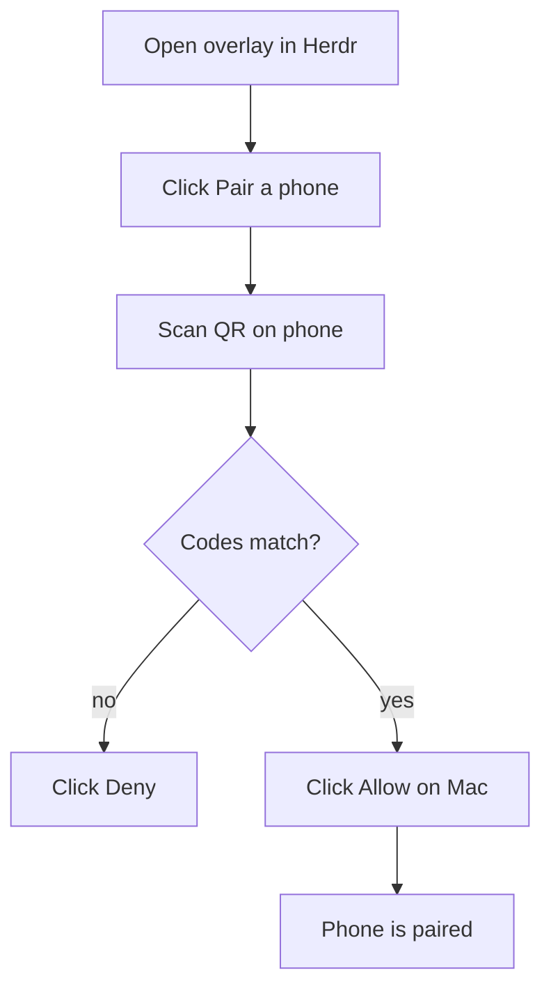
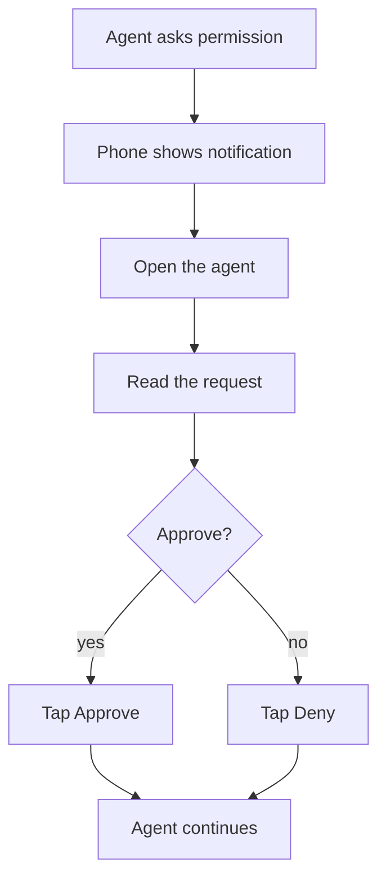

# herdr-remote: Product Requirements

- **Status:** Built. Approved for implementation on 2026-11-08.
- **Date:** 2026-11-08.
- **Owner:** Ajay.
- **Architecture:** [`architecture.md`](architecture.md). The decisions are in [`adr/`](README.md#decisions-adr).
- **Technical design (history):** [`history/technical-design.md`](history/technical-design.md).
- **Design debate (history):** [`history/debate.md`](history/debate.md).
- **Design system:** [`design.md`](design.md) (Pane).

## 1. Summary

herdr-remote is an Android app that controls the Herdr.app sessions on one Mac.

- The user pairs the phone once. Herdr shows a QR code, the phone scans it, and the user confirms on the Mac.
- The user sees spaces, the agents in each space, and a list of all agents.
- For each agent, the user can:
  - read the transcript
  - watch the terminal live
  - approve or deny a permission prompt
  - send a message.
- A small daemon on the Mac is the only part that the phone can reach. It permits a fixed set of safe operations only.
- The phone connects over Wi-Fi, or over Tailscale away from home. There is no relay server.

## 2. Problem

- The user runs many coding agents (Claude Code, Codex) in Herdr.app on a Mac, mostly in auto mode.
- Agents stop and wait when they need a permission or a decision. The user only sees this at the Mac.
- When the user is away from the desk, blocked agents wait for a long time. The user cannot see what the agents do.
- Herdr has no remote access for phones. Herdr is closed source, so the solution must use its shipped interfaces only.

## 3. Goal and success measures

**Goal:** the user can keep agents moving from the phone, safely.

| Measure                                                                 | Target                                                     |
| ----------------------------------------------------------------------- | ---------------------------------------------------------- |
| Time from an agent block to a phone notification                        | 5 s or less, while background watching is on and connected |
| Time from a status change on the Mac to the phone screen                | 2 s or less                                                |
| Live terminal delay on the LAN                                          | about 1 s or less                                          |
| Unpaired or revoked devices that pass the TLS handshake on the API port | none                                                       |
| Phone actions without an audit line                                     | none                                                       |

## 4. User

- **Who:** one developer, the owner of the Mac and the phone.
- **Devices:** one Mac with Herdr.app. One or more Android phones (Android 12 or later) with Google Play services. The app is sideloaded.
- **Context:** the user is away from the desk, for example in another room, in a meeting or outside. The user has a short time and a small screen.

## 5. Scope

**In scope:**

- QR pairing with a confirmation on the Mac.
- The Spaces, Space and All agents views.
- The agent transcript for Claude Code and Codex, and terminal text for other agents.
- A live, read-only view of the agent terminal.
- Approve or deny for a permission prompt from Claude Code or Codex (commands and file edits).
- A text message to an agent.
- Notifications for blocked agents while the app is in the background.
- Revocation of a phone from the Mac.
- Access over Wi-Fi and over Tailscale.
- An iOS and iPadOS app with the same features as the Android app ([ADR 0025](adr/0025-ios-app.md)).

**Out of scope:**

- Keyboard input into a terminal.
- Answers to login prompts, to Codex questions, and free-text answers to questions.
- Interrupts.
- Start or stop of agents, spaces or tabs.
- Agents on remote machines that Herdr reaches over SSH.
- An App Store or TestFlight release of the iOS app.
- A relay server or a push service.
- A Play Store release.
- Changes to Herdr.app or to its shipped mods.

## 6. User flows

### 6.1 Pair a phone

This flow shows the first pairing.

1. The user opens the herdr-remote overlay in Herdr.
2. The user clicks **Pair a phone**. A QR code shows, valid for 120 s.
3. The user scans the QR code in the app.
4. The phone and the Mac both show the phone name and a 6-digit code.
5. If the codes match, the user clicks **Allow** on the Mac. If not, the user clicks **Deny**.

### 6.2 Check and unblock an agent

This flow shows what happens when an agent needs a permission.

1. An agent on the Mac asks for a permission, for example to run a command or to edit a file.
2. The phone shows a notification. The lock screen shows only the agent name and "needs approval".
3. The user unlocks the phone and opens the agent. Or the user expands the notification, reads the prompt there and taps **Approve** or **Deny** (then skip to step 6).
4. The app shows the request: the command or the file, and the text of the prompt.
5. The user taps **Approve** or **Deny**.
6. The app shows the result:
   - **Applied:** the agent reacted.
   - **Sent, not confirmed:** the key was sent, but the agent has not reacted yet.
   - **Uncertain:** someone used the Mac keyboard or mouse during the action. Check the agent.
   - **Outcome unknown:** the connection or the daemon stopped during the action. Check the agent before you try again.
   - **Refused:** no key was sent, with the reason.

### 6.3 Other flows

- **Browse:** Spaces, then a space, then an agent. The All agents view shows blocked agents first.
- **Watch:** on the agent screen, the Live tab shows the terminal in color, like a screen share. The user can zoom with two fingers.
- **Read:** the Transcript tab shows the prompts and the answers. Each run of tool calls between two texts folds into one row that opens with a tap. The user scrolls up to load older pages; a fling stops at a message start. While the agent works, new items appear and the list follows them until the user scrolls up. The header shows the model.
- **Message:** the user types a message and taps Send. It arrives at the agent as a new prompt.
- **Revoke:** on the Mac, the user opens the overlay and clicks **Revoke** next to the phone.

## 7. Functional requirements

| ID    | Requirement                                                                                                                                                                                                                                                                                                        |
| ----- | ------------------------------------------------------------------------------------------------------------------------------------------------------------------------------------------------------------------------------------------------------------------------------------------------------------------ |
| FR-1  | Herdr shows a pairing QR code in an overlay, only after the user clicks **Pair a phone**.                                                                                                                                                                                                                          |
| FR-2  | Pairing needs a scan of the QR code and an Allow on the Mac. A QR code alone pairs nothing.                                                                                                                                                                                                                        |
| FR-3  | A pairing window lasts 120 s. One QR code pairs at most one phone.                                                                                                                                                                                                                                                 |
| FR-4  | The overlay lists the paired phones and can revoke each one. A revoke takes effect within 2 s, also for open streams.                                                                                                                                                                                              |
| FR-5  | The app lists the Herdr spaces by name, with their agents and the status of each agent.                                                                                                                                                                                                                            |
| FR-6  | The app has an All agents view, with blocked agents first.                                                                                                                                                                                                                                                         |
| FR-7  | Status changes on the Mac show on the phone within 2 s.                                                                                                                                                                                                                                                            |
| FR-8  | The app shows the transcript of a Claude Code agent, and of a Codex agent that runs with `--no-daemon`. For other agents it shows the terminal text, with a label. For a Codex in daemon mode, it also shows a hint to start Codex with `--no-daemon`. The app never guesses which transcript belongs to an agent. |
| FR-9  | The app shows a live, colored, read-only view of the terminal of an agent.                                                                                                                                                                                                                                         |
| FR-10 | The user can approve or deny a permission prompt from Claude Code or Codex. This covers commands and file edits.                                                                                                                                                                                                   |
| FR-11 | The app refuses an approval, with the reason, in three cases. The prompt changed. Someone already answered it. Someone uses the Mac keyboard or mouse at that time.                                                                                                                                                |
| FR-12 | The user can answer a Claude Code question from the phone, with a key for each option, under the approval guard. Login prompts, Codex questions and other agents' prompts are view-only. The app says "Answer this on the Mac".                                                                                    |
| FR-13 | The user can send a text message of up to 4000 characters to an idle or working agent. It arrives as a normal prompt, at most once for each send. If the outcome is unknown, the app says so and does not send again by itself.                                                                                    |
| FR-14 | Background watching is optional. When it is on, the phone shows one notification for each blocked episode and one when an agent finishes. A blocked alert shows the prompt and has Approve and Deny. Watching starts again after a reboot, and after an app update at the latest when the app opens.               |
| FR-15 | The phone connects over the LAN or over Tailscale, with the same pairing.                                                                                                                                                                                                                                          |
| FR-16 | On Android, the Spaces header opens a panel with Claude Code and Codex usage, reset times, and a manual Refresh key.                                                                                                                                                                                               |

## 8. Security and privacy requirements

| ID    | Requirement                                                                                                                                                                                                                                                                        |
| ----- | ---------------------------------------------------------------------------------------------------------------------------------------------------------------------------------------------------------------------------------------------------------------------------------- |
| SR-1  | Only paired phones can complete a connection to the API port. The TLS handshake there rejects every other device. The enrollment port opens only during a 120 s pairing window. The user starts that window on the Mac. The port accepts only the one-time token from the QR code. |
| SR-2  | The phone can use only the operations in FR-5 to FR-13. It cannot run commands, read or write files, or start programs on the Mac.                                                                                                                                                 |
| SR-3  | The phone checks the identity of the Mac with a key pin from the QR code. It does not trust certificate names.                                                                                                                                                                     |
| SR-4  | The private key of the phone stays in Android Keystore and never leaves it.                                                                                                                                                                                                        |
| SR-5  | A revoked phone cannot connect again, also with a resumed TLS session.                                                                                                                                                                                                             |
| SR-6  | One user action causes at most one key press or one message. This is also true after a retry, a second phone or a daemon restart. The daemon refuses a request older than 5 minutes.                                                                                               |
| SR-7  | The daemon refuses a phone approval while the Mac keyboard or mouse is in use (a setting, default 10 s).                                                                                                                                                                           |
| SR-8  | The daemon writes an audit line for each pairing event, revocation, decision, refusal and message.                                                                                                                                                                                 |
| SR-9  | No log on the Mac or the phone contains tokens, pairing codes, keys, transcript text, terminal bytes or message text.                                                                                                                                                              |
| SR-10 | After 5 minutes in the background, the app asks for a biometric or the device credential before it shows anything.                                                                                                                                                                 |
| SR-11 | The recents screen shows no app content. Screenshots can show it ([ADR 0024](adr/0024-allow-screenshots.md)). The lock screen shows no command and no prompt. It can show the agent name.                                                                                          |
| SR-12 | The phone keeps transcripts and terminal data in memory only.                                                                                                                                                                                                                      |
| SR-13 | The live view shows terminal bytes in a WebView that can load only bundled files and cannot send input.                                                                                                                                                                            |

**Trust boundary:** programs that run as the same macOS user are trusted. They can already control Herdr directly. The design protects against the network, leaked QR codes, lost phones, second phones, replays, and hostile terminal or transcript content.

## 9. Non-functional requirements

| Area          | Requirement                                                                                                                           |
| ------------- | ------------------------------------------------------------------------------------------------------------------------------------- |
| Compatibility | Herdr.app 0.1.13, hc 0.1.18, Claude Code 2.1.x, Codex 0.167.x. A prompt that the app does not know is view-only.                      |
| Platforms     | macOS on Apple silicon. Android 12 (API 31) or later, target API 35.                                                                  |
| Reliability   | The daemon runs as a LaunchAgent and starts again after a reboot or a crash. The phone reconnects after a network change within 40 s. |
| Resource use  | At most 2 live views for each phone. A slow phone drops the backlog and repaints, and does not freeze.                                |
| Footprint     | One Go binary, one Herdr mod, one Android app. No server, no database.                                                                |

## 10. Setup requirements

[Deployment](deployment.md) gives the steps.

- **Mac:**
  - Run `scripts/install.sh`. It installs the daemon, the LaunchAgent and the Herdr mod.
  - Allow incoming connections for `herdr-remoted` if the macOS firewall asks.
  - Install Tailscale for access away from home.
  - Set Herdr's Codex launcher to `["codex", "--no-daemon"]` in Herdr settings (`new-menu.agents`). Without it, Codex agents show terminal text, not the transcript. `hc --skill` also asks for `--no-daemon` for Codex under hc.
- **Build machine (the same Mac):** run `scripts/setup-android.sh`. It installs the Android command-line tools and Gradle with Homebrew. No Android Studio.
- **Phone:** Android 12 or later with Google Play services. Install the APK with `adb`. Install Tailscale for access away from home.

## 11. Acceptance criteria

The product is done when all 13 [acceptance criteria](testing.md#acceptance-criteria) pass. They must pass on the emulator and on a real phone. In short:

1. The daemon runs after a reboot, and rejects unpaired TLS clients.
2. Pairing works with a matching code and Allow, and fails safely in every other case.
3. Spaces, agents and status show correctly and stay current.
4. Transcripts show for Claude Code and for Codex with `--no-daemon`. Other agents show labelled terminal text.
5. The live view is colored, current, and recovers from resize, heavy output and network changes.
6. Approve and deny work for command and file-edit prompts, with the refusals in FR-11.
7. Messages arrive as normal prompts, at most once for each send.
8. Background notifications arrive within 5 s, also after a reboot.
9. A revoke ends access within 2 s.
10. Tailscale access works over cellular.
11. The app gate appears after 5 minutes in the background.
12. Recents and the lock screen show no content.
13. The audit log is complete and contains no secrets or content.

## 12. Risks

| Risk                                                                      | Impact                                         | Response                                                                                                                                                            |
| ------------------------------------------------------------------------- | ---------------------------------------------- | ------------------------------------------------------------------------------------------------------------------------------------------------------------------- |
| A phone approval lands on a different prompt (rare race)                  | An action is approved that nobody saw          | Mac-in-use guard, prompt hash and turn checks, `uncertain` result, audit line. Accepted residual risk: the guard does not see SSH input or input from other agents. |
| Claude Code or Codex changes its prompt text                              | Approve and deny stop working                  | The prompt becomes view-only (safe). Update the markers.                                                                                                            |
| Undocumented transcript files change                                      | Transcripts stop working                       | Terminal text shows as the fallback.                                                                                                                                |
| Codex runs in daemon mode, which is the default of Herdr's Codex launcher | Terminal text in place of the Codex transcript | Set Herdr's Codex launcher to `codex --no-daemon` once. The app shows a hint.                                                                                       |
| The phone OS stops the background service                                 | Missed notifications                           | Battery-optimization exemption, restart on reboot. Alerts come only while the service is connected.                                                                 |
| A device keeps the Mac "in use" (for example a mouse jiggler)             | Approvals always refused                       | Set `mac_idle_seconds` to 0.                                                                                                                                        |

## 13. Milestones

The build steps are in the [technical design, section 5](history/technical-design.md#5-implementation-plan). M1 to M3 are done. M4 passed on a real phone on 2026-11-10, with two checks open in [testing](testing.md#checks-on-a-real-phone).

| Milestone           | Build steps | Result                                                        |
| ------------------- | ----------- | ------------------------------------------------------------- |
| M1: Daemon core     | 1 to 4      | Pairing from the command line, read API, events.              |
| M2: Daemon features | 5 to 8      | Live view, transcripts, approvals, messages, mod and install. |
| M3: Android app     | 9 to 11     | Pairing, lists, background alerts, agent screen.              |
| M4: Acceptance      | 12          | All 13 criteria pass on the emulator and a real phone.        |

## 14. Open questions

None block the work. These are assumptions, with a safe fallback for each:

- Claude auto-mode prompts probably look like the default-mode prompts. If not, they are view-only.
- The payloads of hc events are not documented. The implementer records them before writing the event code.
